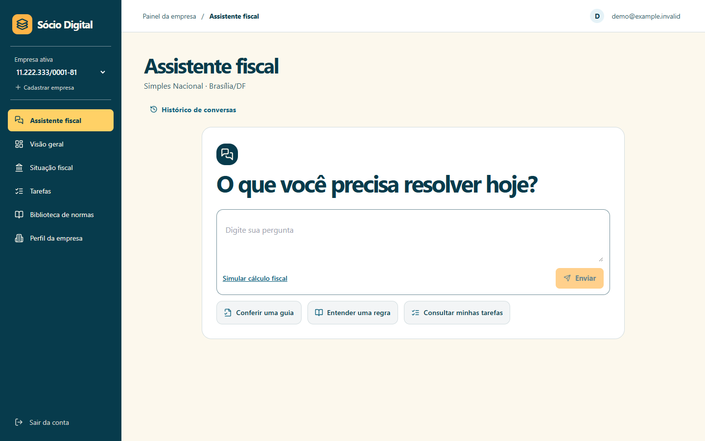

# Sócio Digital

**Assistente fiscal para MEIs e pequenos negócios brasileiros.**

O Sócio Digital reúne perguntas, documentos e tarefas fiscais no contexto de cada empresa. Você pode consultar uma regra, abrir o trecho da norma citado na resposta e transformar uma orientação em tarefa. A conversa mantém o histórico e pode pedir o mês de referência (competência) quando ele é necessário para responder.



*Assistente fiscal no tema original, com uma empresa de demonstração.*

## O que você pode fazer

| Recurso | Como usar |
| --- | --- |
| **Assistente fiscal** | Cadastre a empresa, faça uma pergunta e retome a conversa quando precisar. O assistente considera o contexto cadastral e pode solicitar esclarecimentos. |
| **Biblioteca de normas** | Pesquise o acervo por assunto, tipo, órgão ou vigência. Abra uma citação para ler a versão consultada e o trecho que fundamenta a resposta. |
| **Situação fiscal** | Registre guias, comprovantes e certidões. A interface distingue as evidências que você adicionou da situação verificada oficialmente. |
| **Tarefas** | Crie uma tarefa a partir de uma orientação do assistente e acompanhe o que está pendente ou concluído. |
| **Simulação tributária** | Informe os dados do período para simular cenários de MEI ou Simples Nacional cobertos por uma regra revisada. |

O acervo jurídico é alimentado por ingestão administrativa. A cobertura depende dos documentos publicados e das regras habilitadas. As respostas são informativas e ajudam a preparar a revisão com um profissional contábil.

## Rode localmente

Você precisa de **Git**, **Docker com Compose** e **Ollama** em execução. Clone o repositório e execute o script no PowerShell.

```powershell
git clone https://github.com/ingrdsoares/RES-IA-Challenge-2.git
cd RES-IA-Challenge-2
./scripts/rodar-localmente.ps1
```

O script baixa os modelos do Ollama, aguarda os serviços de dados, aplica as migrações e inicia a plataforma. As execuções seguintes reaproveitam os volumes do Compose. Para executar as etapas manualmente, consulte o [guia do backend](backend/README.md).

Abra a [plataforma em localhost:3000](http://localhost:3000), crie uma conta e cadastre a empresa. A [API no Swagger](http://localhost:8000/docs) está disponível na porta 8000.

Para testar o percurso com citação, ingira o excerto de referência da LC 123/2006 e pergunte ao assistente sobre a periodicidade do recolhimento pelo documento único de arrecadação. A referência e o comando de ingestão estão no [roteiro de reprodução local](docs/superpowers/plans/2026-11-17-integracao-multiagente.md#reprodução-local-da-primeira-entrega). Consulte o [guia do backend](backend/README.md) para configurar o Ollama, publicar outras normas e rodar os testes de integração.

### Usar Gemini ou DeepSeek na geração

Por padrão, as respostas são geradas pelo Qwen no Ollama. Para gerá-las por uma API na nuvem, defina em `backend/.env`:

```env
LLM_PROVIDER=google            # ou deepseek
GOOGLE_API_KEY=sua-chave       # ou DEEPSEEK_API_KEY=sua-chave
GENERATION_MODEL=gemini-3.5-flash   # ou deepseek-flash
```

A pergunta e os trechos recuperados do acervo passam a ser enviados ao provedor escolhido. Os embeddings e o reranker continuam locais, então o Ollama segue necessário, só com o modelo de embedding. Os limites de contexto (`NUM_CTX`, `MAX_CONTEXT_CHARS`) não mudam com o provedor.

No Gemini, os modelos que raciocinam por padrão gastam nisso parte do limite de tokens da resposta, que pode sair cortada. `GOOGLE_REASONING_EFFORT` define o nível enviado; vazio (padrão) usa o do modelo. Os níveis aceitos variam por modelo. Testado em 19/11/2026:

| Modelo | Valor recomendado |
|--------|-------------------|
| `gemini-3.5-flash` | `minimal` (sem ele, cerca de 600 tokens vão para o raciocínio) |
| `gemini-3.1-flash-lite`, `gemini-3.5-flash-lite` | vazio ou `minimal` (não raciocinam por padrão) |
| `gemini-3.8-flash`, `gemini-flash-latest` | não aceitam `minimal`; deixe vazio |

O `gemini-2.5-flash` não está mais disponível para contas novas.

## Como funciona

1. O **frontend React + TypeScript** envia a pergunta à API e acompanha o processamento sem perder o contexto da conversa.
2. A **API FastAPI** persiste os dados no PostgreSQL e enfileira o trabalho no Redis.
3. O **worker** coordena recuperação jurídica, diagnóstico fiscal e planejamento. O Qdrant recupera trechos do acervo e o Ollama executa os modelos Qwen.
4. A resposta volta com as fontes e os próximos passos disponíveis. O armazenamento compatível com S3 atende os documentos e anexos.

| Onde | O que você encontra |
| --- | --- |
| [`frontend/`](frontend/) | Aplicação web, testes de navegador e [design system](frontend/DESIGN-SYSTEM.md). |
| [`backend/api/`](backend/api/) | API, worker, migrações e testes do produto. |
| [`backend/crawler/`](backend/crawler/) | Coleta de fontes fiscais. |
| [`backend/refino/`](backend/refino/) | Preparação do acervo para recuperação de trechos. |
| [`backend/evaluation/`](backend/evaluation/) | Avaliação da qualidade do RAG. |
| [`docs/`](docs/) | Documentação, diagramas e entregáveis do projeto. |

Para trabalhar na interface, pare o container `frontend`, mantenha a API local em execução e use `npm ci` e `npm run dev` dentro de `frontend/`. No mesmo diretório, `npm test` roda os testes unitários e `npm run build` gera a versão de produção.

## Origem

O Sócio Digital nasceu no **Grupo 08 do Challenge 2 da Residência em Inteligência Artificial (RES-IA)**. Conheça a [equipe e as frentes de trabalho](docs/projeto/equipe.md).
