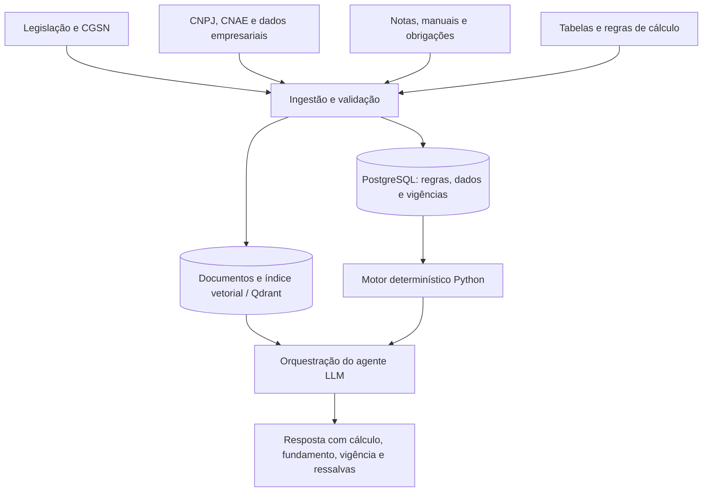

# Base tributária brasileira para agentes de IA

> **Levantamento de fontes, documentação, repositórios, lacunas e proposta de arquitetura**  
> **Foco inicial:** MEIs e microempresas optantes pelo Simples Nacional  
> **Data de organização:** 03/11/2026

## 1. Objetivo

Construir uma base de conhecimento e uma camada de regras para um sistema de IA que ajude MEIs e microempresas a compreender obrigações, conferir enquadramentos, simular tributos e monitorar alterações legislativas com **fundamentação verificável**.

O ponto de partida é o repositório [Matheuscfs/legislacao-tributaria](https://github.com/Matheuscfs/legislacao-tributaria), que agrega legislação e dados tributários em formatos úteis para processamento automatizado. **Ele é uma fonte de informação, não um sistema contábil nem um motor de cálculo completo.**

### Capacidades pretendidas

1. Diagnóstico tributário e de enquadramento (MEI, Simples Nacional, CNAE e atividades exercidas).
2. Simulação do Simples Nacional: anexos, alíquota efetiva, Fator R e DAS.
3. Consulta jurídica por RAG, com artigo, norma, origem e vigência.
4. Identificação de obrigações acessórias e prazos aplicáveis.
5. Monitoramento de mudanças legislativas relevantes para cada empresa.
6. Leitura e validação preliminar de documentos fiscais, em etapa posterior.

> **Nota de confiabilidade:** Links e projetos externos devem ter versões, disponibilidade, licença, manutenção e abrangência novamente verificados antes do uso em produção. Repositórios de terceiros não substituem fontes oficiais nem revisão contábil/jurídica.

---

## 2. Repositórios e ferramentas identificados

| Projeto / ferramenta | Link | Finalidade | Papel no sistema | Atenção |
|---|---|---|---|---|
| **legislacao-tributaria** (Matheuscfs) | [GitHub](https://github.com/Matheuscfs/legislacao-tributaria) | Coleta/organização de legislação tributária; histórico de alterações via Git; materiais em Markdown, CSV e JSON | Base inicial de normas e monitoramento de mudanças | Checar atualização, cobertura, vigência e fonte de cada arquivo |
| **simples-nacional-br** | [GitHub](https://github.com/peterwkdev-creator/simples-nacional-br) | Biblioteca Python para simulações de Simples, Fator R, alíquota efetiva e DAS; declara suporte MCP | Referência para motor matemático e ferramentas de agentes | Validar fórmulas, versões, testes e resultados contra fontes oficiais/PGDAS-D |
| **cnae-ibge** | [GitHub](https://github.com/Benedito00/cnae-ibge) | Coleta de subclasses CNAE e enriquecimentos para MEI/Simples | Classificação e pré-análise de enquadramento | CNAE sozinho **não determina** o anexo tributário |
| **cnpj-data-pipeline** | [GitHub](https://github.com/caiopizzol/cnpj-data-pipeline) | Download, processamento e carga de dados abertos de CNPJ em PostgreSQL | Base cadastral para consultas e integração | Dados públicos não incluem faturamento privado ou folha da empresa |
| **rfb-cnpj-etl** | [GitHub](https://github.com/msantosjader/rfb-cnpj-etl) | ETL da base pública de CNPJ para SQLite/PostgreSQL | Alternativa ao pipeline de CNPJ | Comparar facilidade de execução, desempenho e manutenção |
| **lexml-toolkit** | [GitHub](https://github.com/lexml/lexml-toolkit) | Ferramentas relacionadas ao ecossistema LexML | Auxílio na descoberta/estruturação jurídica | Conferir compatibilidade atual e casos de uso do repositório |

### Destaques de avaliação

- **Primeiro candidato a estudar para cálculos:** `simples-nacional-br`. Pode acelerar um protótipo, mas o cálculo final precisa de testes independentes e aderência à competência e às situações especiais.
- **Primeiro candidato para CNAE:** `cnae-ibge`, idealmente reconciliado com a [API oficial do IBGE](https://servicodados.ibge.gov.br/api/v2/cnae/subclasses).
- **Para dados empresariais:** escolher **um** pipeline de CNPJ inicialmente; não há necessidade de adotar dois ETLs paralelos.
- **Para normas:** manter fonte, data de coleta, versão e vigência; um commit recente não prova, por si só, que uma norma está juridicamente vigente.

---

## 3. Documentação oficial: Simples Nacional e MEI

Essas são fontes prioritárias para preencher as lacunas entre o texto da lei e a **apuração operacional** de impostos e obrigações.

| Fonte | Link | Informações esperadas | Uso planejado |
|---|---|---|---|
| **Portal de manuais do Simples Nacional** | [Manuais oficiais](https://www8.receita.fazenda.gov.br/SimplesNacional/ConteudoApoio/Manuais/TelaManuais.aspx) | Manuais operacionais e materiais de apoio | RAG para orientações e regras operacionais |
| **Resolução CGSN nº 140/2018** | [Norma oficial](https://normas.receita.fazenda.gov.br/sijut2consulta/link.action?idAto=92278) | Regras detalhadas do Simples, anexos, hipóteses especiais e obrigações | Núcleo jurídico do Simples Nacional |
| **Perguntas e Respostas do Simples Nacional** | [PDF](https://www8.receita.fazenda.gov.br/simplesnacional/arquivos/manual/perguntaosn.pdf) | Casos comuns, interpretações didáticas e exemplos | Complemento de explicação e avaliação do RAG |
| **PGDAS-D** | [Serviço oficial](https://www.gov.br/pt-br/servicos/declarar-apuracoes-mensais-do-simples-nacional) | Processo de apuração mensal e declaração | Referência para regras e validação de simulações |
| **Perguntas frequentes MEI** | [Portal Gov.br](https://www.gov.br/empresas-e-negocios/pt-br/empreendedor/servicos-para-mei/perguntas-frequentes) | Condições e obrigações do microempreendedor individual | RAG específico para MEI |
| **Ocupações permitidas para MEI** | [Relação oficial](https://www.gov.br/empresas-e-negocios/pt-br/empreendedor/quero-ser-mei/quais-as-ocupacoes-que-podem-ser-mei/) | Ocupações e atividades admitidas | Validação de elegibilidade, com vigência |

### Dados estruturados a extrair

- Anexos I a V: faixas de receita, alíquotas nominais, parcelas a deduzir e repartições.
- Fórmulas de alíquota efetiva e base de receita acumulada (RBT12), com regras para início de atividade.
- Atividades sujeitas a Fator R e regras aplicáveis à folha/pró-labore.
- Limites de faturamento, sublimites e condições de enquadramento/desenquadramento.
- Regras específicas do SIMEI, inclusive valores e obrigações por competência.
- Regras de segregação de receitas e exceções.

**Não usar o LLM como calculadora ou árbitro único de enquadramento.** O LLM explica e solicita dados; funções determinísticas calculam; as regras precisam ser verificáveis e versionadas.

---

## 4. CNAE, CNPJ e informações cadastrais

| Fonte | Link | Conteúdo / uso | Limitação |
|---|---|---|---|
| **API CNAE do IBGE** | [Endpoint de subclasses](https://servicodados.ibge.gov.br/api/v2/cnae/subclasses) | Descrições, códigos e hierarquias CNAE | Necessário cruzar com outras regras para determinar tributação |
| **Dados Abertos da Receita Federal** | [Portal de dados abertos](https://www.gov.br/receitafederal/pt-br/acesso-a-informacao/dados-abertos) | Informações cadastrais públicas de CNPJ: empresas, estabelecimentos, CNAEs, sócios, opções quando disponibilizadas | Não substitui consulta cadastral atual nem fornece dados financeiros privados |
| **Consulta oficial de CNPJ via Serpro** | [Descrição do serviço](https://www.gov.br/pt-br/servicos/obter-solucao-de-consulta-de-dados-do-cadastro-nacional-de-pessoas-juridicas-cnpj) | Possibilidade de consulta integrada a registros | Serviço sujeito a contratação, credenciais e condições de acesso |
| **cnae-ibge** | [GitHub](https://github.com/Benedito00/cnae-ibge) | Coleta/enriquecimento de CNAE | Validar data e regras de elegibilidade |
| **cnpj-data-pipeline** | [GitHub](https://github.com/caiopizzol/cnpj-data-pipeline) | ETL para PostgreSQL | Carga de dados pode ser volumosa |
| **rfb-cnpj-etl** | [GitHub](https://github.com/msantosjader/rfb-cnpj-etl) | ETL alternativo | Conferir manutenção e licença |

### Campos cadastrais relevantes

- CNPJ, razão social, natureza jurídica, município e UF.
- Situação cadastral e data de abertura.
- CNAE principal e secundários.
- Opção pelo Simples Nacional e SIMEI, conforme disponibilidade e competência.

### Campos que precisam ser fornecidos pela empresa ou por integrações autorizadas

- Faturamento mês a mês e receita acumulada dos 12 meses anteriores.
- Receita segregada por tipo de atividade/prestação.
- Folha de pagamento, pró-labore e encargos relevantes para o Fator R.
- Notas fiscais, retenções, impostos pagos, guias e declarações.
- Informações sobre matriz/filiais, operações interestaduais e particularidades fiscais.

**Privacidade e acesso:** obter consentimento/base legal apropriada, limitar coleta ao necessário, controlar acesso por empresa e proteger dados em conformidade com a LGPD.

---

## 5. Notas fiscais e documentação fiscal eletrônica

**Principal fonte:** [Documentação técnica da NFS-e Nacional](https://www.gov.br/nfse/pt-br/biblioteca/documentacao-tecnica/documentacao-atual)

Material relevante a catalogar:

- Manual da API para contribuintes.
- Leiautes de DPS/NFS-e.
- Esquemas XSD para validação estrutural.
- Tabelas e anexos de classificação de serviços, incluindo a referência à NBS.
- Regras de ambiente de homologação e produção.

### Possíveis aplicações

1. Extrair informações de NFS-e em formato estruturado.
2. Conferir se os campos declarados são compatíveis com o tipo de operação.
3. Associar documento, serviço e normas aplicáveis.
4. Gerar alertas de inconsistências para revisão humana.
5. Futuramente integrar consulta e emissão, **apenas** com credenciais, autorização e requisitos técnicos atendidos.

**Atenção:** disponibilidade de documentação de API não implica acesso irrestrito ao serviço ou permissão para consultar/emitar notas de terceiros.

---

## 6. Interpretação administrativa, legislação e jurisprudência

| Fonte | Link | Uso potencial |
|---|---|---|
| **Soluções de Consulta e Divergência da Receita Federal** | [Acervo oficial](https://www.gov.br/receitafederal/pt-br/acesso-a-informacao/legislacao/solucoes-de-consultas-e-de-divergencias) | Recuperar interpretações administrativas relevantes para casos específicos |
| **LexML** | [Portal](https://www.lexml.gov.br/) | Localizar legislação e referências jurídicas de diferentes esferas, conforme cobertura |
| **Acervo LexML no Senado** | [Dados abertos / orientação](https://www12.senado.leg.br/dados-abertos/legislativo/legislacao/acervo-do-portal-lexml) | Entender possibilidades de consulta e integração |
| **lexml-toolkit** | [GitHub](https://github.com/lexml/lexml-toolkit) | Ferramentas auxiliares para o ecossistema LexML |
| **CONFAZ** | [Portal oficial](https://www.confaz.fazenda.gov.br/) | Convênios, protocolos e ajustes relacionados ao ICMS |

### Metadados indispensáveis para RAG jurídico

- `source_url` (link oficial), `source_type` (lei, resolução, manual, consulta etc.).
- `jurisdiction` (federal, estadual, municipal), `issuer`, `document_id`.
- `publication_date`, `effective_from`, `effective_until` (quando disponíveis).
- `collected_at`, `last_checked_at`, checksum e versão.
- Artigo, parágrafo, inciso e seção, quando aplicáveis.
- Status de vigência e relação de alteração/revogação, com verificação.

**Importante:** uma solução de consulta deve ser classificada como interpretação administrativa, não como se fosse texto de lei de aplicação universal. A jurisprudência do CARF e dos tribunais pode ser uma etapa posterior, com tratamento de precedentes e divergências.

---

## 7. Obrigações acessórias, prazos e escrituração

| Fonte | Link | Utilidade |
|---|---|---|
| **Agenda Tributária da Receita — 2026** | [Agenda](https://www.gov.br/receitafederal/pt-br/assuntos/agenda-tributaria/2026) | Vencimentos e obrigações por competência, sujeitos a atualizações |
| **DCTFWeb** | [Orientações e documentação](https://www.gov.br/receitafederal/pt-br/assuntos/orientacao-tributaria/declaracoes-e-demonstrativos/DCTFWeb) | Identificar requisitos, manuais e condições de entrega |
| **eSocial** | [Documentação técnica](https://www.gov.br/esocial/pt-br/documentacao-tecnica/) | Eventos, leiautes e normas relativas a trabalho/folha |
| **EFD-Reinf** | [Manuais e documentação](https://www.gov.br/sped/pt-br/assuntos/escrituracoes-digitais/efd-reinf/manuais-e-documentos-tecnicos) | Escrituração fiscal e retenções |
| **DASN-SIMEI** | [Como fazer](https://www.gov.br/empresas-e-negocios/pt-br/empreendedor/servicos-para-mei/declaracao-anual-de-faturamento/como-fazer-a-dasn) | Declaração anual do MEI |
| **PGDAS-D** | [Serviço](https://www.gov.br/pt-br/servicos/declarar-apuracoes-mensais-do-simples-nacional) | Apuração mensal do Simples Nacional |

### Modelo de tabela de obrigações

| Campo | Significado |
|---|---|
| `obligation_code` | Identificador, ex.: `PGDAS_D` |
| `tax_regime` | Regime ao qual pode se aplicar |
| `business_conditions` | Condições específicas de exigibilidade |
| `periodicity` | Mensal, anual, eventual etc. |
| `competence` | Período de referência |
| `due_date_rule` | Regra de vencimento, incluindo exceções |
| `source_url` | Fundamentação oficial |
| `effective_from` / `effective_until` | Vigência |
| `last_verified_at` | Última conferência |

**Nunca presumir que toda obrigação se aplica a todo MEI ou microempresa.** O resultado deve ser derivado das condições de cada obrigação e do perfil empresarial.

---

## 8. Legislação estadual e municipal; reforma tributária

| Fonte | Link | Papel |
|---|---|---|
| **LexML** | [Portal](https://www.lexml.gov.br/) | Descoberta de normas subnacionais onde houver cobertura |
| **CONFAZ** | [Portal](https://www.confaz.fazenda.gov.br/) | Atos nacionais relacionados ao ICMS |
| **NFS-e Nacional** | [Biblioteca técnica](https://www.gov.br/nfse/pt-br/biblioteca/documentacao-tecnica) | Padrões e documentação técnica de serviços |
| **Cronograma da reforma tributária** | [Orientações da Receita](https://www.gov.br/receitafederal/pt-br/acesso-a-informacao/acoes-e-programas/reforma-tributaria-do-consumo/orientacoes-da-reforma-tributaria/cronograma) | Marcos de implantação e obrigações em transição |

### Estratégia recomendada

- **MVP:** focar em MEIs e microempresas prestadoras de serviços optantes pelo Simples Nacional, com um conjunto definido de atividades e municípios.
- **Fase 2:** incluir ISS municipal e documentos locais para os municípios priorizados.
- **Fase 3:** expandir regras de ICMS e operações interestaduais.
- **Sempre:** registrar data da competência; regras novas nem sempre se aplicam a competências passadas.

Uma única base nacional de ISS/ICMS pronta para uso em RAG, com cobertura e vigência universalmente confiáveis, **não foi estabelecida neste levantamento**. Será preciso definir cobertura e criar coletores ou integrações locais.

---

## 9. Mapa de lacunas e como preenchê-las

| Lacuna | Melhor fonte inicial | Trabalho adicional |
|---|---|---|
| Resoluções do CGSN | [CGSN 140/2018](https://normas.receita.fazenda.gov.br/sijut2consulta/link.action?idAto=92278) | Coleta, particionamento por dispositivo e vigência |
| MEI e SIMEI | [Perguntas MEI](https://www.gov.br/empresas-e-negocios/pt-br/empreendedor/servicos-para-mei/perguntas-frequentes), [ocupações](https://www.gov.br/empresas-e-negocios/pt-br/empreendedor/quero-ser-mei/quais-as-ocupacoes-que-podem-ser-mei/) | Regras de elegibilidade, limites e desenquadramento |
| Anexos e cálculos do Simples | [CGSN 140](https://normas.receita.fazenda.gov.br/sijut2consulta/link.action?idAto=92278), [simples-nacional-br](https://github.com/peterwkdev-creator/simples-nacional-br) | Estruturar tabelas, validar fórmulas e criar testes |
| CNAE e classificação | [IBGE](https://servicodados.ibge.gov.br/api/v2/cnae/subclasses), [cnae-ibge](https://github.com/Benedito00/cnae-ibge) | Relacionar atividade efetiva a regras, com revisão |
| CNPJ e empresa | [Dados abertos RFB](https://www.gov.br/receitafederal/pt-br/acesso-a-informacao/dados-abertos), [pipeline](https://github.com/caiopizzol/cnpj-data-pipeline) | ETL e coleta autorizada de dados privados |
| Obrigações e prazos | [Agenda](https://www.gov.br/receitafederal/pt-br/assuntos/agenda-tributaria/2026), [DCTFWeb](https://www.gov.br/receitafederal/pt-br/assuntos/orientacao-tributaria/declaracoes-e-demonstrativos/DCTFWeb) | Motor de exigibilidade e calendários por competência |
| Interpretações oficiais | [Soluções de Consulta](https://www.gov.br/receitafederal/pt-br/acesso-a-informacao/legislacao/solucoes-de-consultas-e-de-divergencias) | Recuperação contextual e controle de aplicabilidade |
| NFS-e | [Documentação técnica](https://www.gov.br/nfse/pt-br/biblioteca/documentacao-tecnica/documentacao-atual) | Parser, validação de schema e acesso autorizado |
| Estados/municípios | [LexML](https://www.lexml.gov.br/), [CONFAZ](https://www.confaz.fazenda.gov.br/) | Cobertura local, versionamento e verificação |
| Reforma tributária | [Cronograma oficial](https://www.gov.br/receitafederal/pt-br/acesso-a-informacao/acoes-e-programas/reforma-tributaria-do-consumo/orientacoes-da-reforma-tributaria/cronograma) | Acompanhar implementação, regras transitórias e leiautes |

---

## 10. Arquitetura proposta

### Responsabilidades de cada componente

**RAG jurídico (ex.: Qdrant)**
- Recupera artigos, normas, manuais e interpretações relevantes.
- Exige links oficiais, metadados de competência e referência textual.
- Não é fonte única para cálculos numéricos.

**Banco relacional (ex.: PostgreSQL)**
- Armazena perfis empresariais autorizados, CNAEs, tabelas e obrigações.
- Registra as versões e períodos de validade de regras.

**Motor de cálculo (Python)**
- Executa alíquota efetiva, Fator R, DAS e verificações estruturadas.
- Retorna memória de cálculo e identificador da versão das regras.
- Possui testes de regressão para múltiplas competências e casos de borda.

**Agente LLM (ex.: FastAPI + modelo + ferramentas)**
- Entende a intenção, solicita dados faltantes, consulta fontes e chama funções.
- Explica o resultado, aponta incerteza e apresenta referências.
- Não executa ações fiscais ou envia declarações sem autorização explícita.

---

## 11. Roteiro recomendado de implementação

### Etapa 1 — Fonte legislativa
- [ ] Clonar e revisar o repositório `legislacao-tributaria`.
- [ ] Incorporar a Resolução CGSN 140/2018 e manuais do Simples.
- [ ] Criar coletor com link oficial, hash, data de publicação, vigência e versão.
- [ ] Identificar lacunas na cobertura do MEI e das normas complementares.

### Etapa 2 — Cadastros
- [ ] Importar CNAEs da API do IBGE.
- [ ] Mapear ocupações MEI e restrições aplicáveis.
- [ ] Testar `cnpj-data-pipeline` ou `rfb-cnpj-etl` com amostra de dados.
- [ ] Separar dados cadastrais públicos de dados financeiros privados.

### Etapa 3 — Motor tributário
- [ ] Auditar código, licença, manutenção e testes de `simples-nacional-br`.
- [ ] Implementar/validar alíquota efetiva, anexos, Fator R e DAS por competência.
- [ ] Criar cenários de teste comparados a referências oficiais/PGDAS-D.
- [ ] Retornar memória de cálculo rastreável.

### Etapa 4 — RAG auditável
- [ ] Fragmentar normas por artigo/dispositivo, mantendo contexto.
- [ ] Indexar metadados de fonte e vigência.
- [ ] Impedir que fontes expiradas sejam usadas como atuais sem aviso.
- [ ] Avaliar respostas com questões revisadas por profissional habilitado.

### Etapa 5 — Obrigações e alertas
- [ ] Estruturar obrigação, periodicidade, critérios e data de vencimento.
- [ ] Consultar/atualizar agendas oficiais periodicamente.
- [ ] Identificar alterações legislativas relevantes para perfis cadastrados.

### Etapa 6 — Documentos fiscais
- [ ] Criar parser de documentos recebidos com autorização.
- [ ] Validar schemas NFS-e e comparar dados com regras pertinentes.
- [ ] Preparar futuras integrações autenticadas.

---

## 12. Critérios de qualidade e riscos

1. **Temporalidade:** toda resposta deve informar a competência e base de regras aplicada.
2. **Fonte oficial:** a origem usada na conclusão precisa ser acessível e verificável.
3. **Separação de papéis:** normas fundamentam; regras estruturadas decidem condições; funções calculam; o LLM explica.
4. **Cobertura explícita:** se não houver norma municipal/estadual suficiente, declarar a limitação.
5. **Dados pessoais:** coletar o mínimo necessário, controlar acesso e proteger informações.
6. **Auditoria:** registrar entradas, fontes recuperadas, versões das regras e saída dos cálculos.
7. **Validação humana:** casos fiscais complexos, controvertidos ou com impacto financeiro relevante devem ser revisados por contador/advogado qualificado.
8. **Testes:** medir tanto exatidão matemática quanto adequação da norma citada e precisão da interpretação.

### Conjunto de testes sugerido

- Empresas recém-abertas e RBT12 proporcionalizado quando aplicável.
- Atividades sujeitas e não sujeitas ao Fator R.
- Faturamento em diferentes faixas e limites.
- Receitas de diferentes atividades na mesma empresa.
- Mudanças de regra entre competências.
- Documentos com campos fiscais inconsistentes.
- Perguntas sem informação suficiente para concluir.

---

## 13. Seleção recomendada para o MVP

**Cinco componentes centrais:**

1. [legislacao-tributaria](https://github.com/Matheuscfs/legislacao-tributaria) — legislação inicial e histórico.
2. [Resolução CGSN 140/2018](https://normas.receita.fazenda.gov.br/sijut2consulta/link.action?idAto=92278) + [Manuais do Simples](https://www8.receita.fazenda.gov.br/SimplesNacional/ConteudoApoio/Manuais/TelaManuais.aspx) — regras oficiais.
3. [cnae-ibge](https://github.com/Benedito00/cnae-ibge) + [API IBGE](https://servicodados.ibge.gov.br/api/v2/cnae/subclasses) — atividades econômicas.
4. [cnpj-data-pipeline](https://github.com/caiopizzol/cnpj-data-pipeline) — dados cadastrais públicos.
5. [simples-nacional-br](https://github.com/peterwkdev-creator/simples-nacional-br) — referência de implementação para cálculos.

**Primeira entrega funcional:** formulário de perfil da empresa → identificação dos dados faltantes → consulta normativa → simulação em Python → resposta com memória de cálculo, competência, fontes e ressalvas.

**Diferencial futuro:** monitoramento personalizado de alterações em normas e suas consequências potenciais para cada empresa, com revisão e rastreabilidade.

---

## 14. Índice consolidado de links

### Repositórios GitHub
- https://github.com/Matheuscfs/legislacao-tributaria
- https://github.com/peterwkdev-creator/simples-nacional-br
- https://github.com/Benedito00/cnae-ibge
- https://github.com/caiopizzol/cnpj-data-pipeline
- https://github.com/msantosjader/rfb-cnpj-etl
- https://github.com/lexml/lexml-toolkit

### Legislação, Simples Nacional e MEI
- https://www8.receita.fazenda.gov.br/SimplesNacional/ConteudoApoio/Manuais/TelaManuais.aspx
- https://normas.receita.fazenda.gov.br/sijut2consulta/link.action?idAto=92278
- https://www8.receita.fazenda.gov.br/simplesnacional/arquivos/manual/perguntaosn.pdf
- https://www.gov.br/pt-br/servicos/declarar-apuracoes-mensais-do-simples-nacional
- https://www.gov.br/empresas-e-negocios/pt-br/empreendedor/servicos-para-mei/perguntas-frequentes
- https://www.gov.br/empresas-e-negocios/pt-br/empreendedor/quero-ser-mei/quais-as-ocupacoes-que-podem-ser-mei/
- https://www.gov.br/empresas-e-negocios/pt-br/empreendedor/servicos-para-mei/declaracao-anual-de-faturamento/como-fazer-a-dasn

### Cadastros e classificações
- https://servicodados.ibge.gov.br/api/v2/cnae/subclasses
- https://www.gov.br/receitafederal/pt-br/acesso-a-informacao/dados-abertos
- https://www.gov.br/pt-br/servicos/obter-solucao-de-consulta-de-dados-do-cadastro-nacional-de-pessoas-juridicas-cnpj

### NFS-e, obrigações e escrituração
- https://www.gov.br/nfse/pt-br/biblioteca/documentacao-tecnica/documentacao-atual
- https://www.gov.br/nfse/pt-br/biblioteca/documentacao-tecnica
- https://www.gov.br/receitafederal/pt-br/assuntos/agenda-tributaria/2026
- https://www.gov.br/receitafederal/pt-br/assuntos/orientacao-tributaria/declaracoes-e-demonstrativos/DCTFWeb
- https://www.gov.br/esocial/pt-br/documentacao-tecnica/
- https://www.gov.br/sped/pt-br/assuntos/escrituracoes-digitais/efd-reinf/manuais-e-documentos-tecnicos

### Pesquisa jurídica, legislação local e reforma tributária
- https://www.gov.br/receitafederal/pt-br/acesso-a-informacao/legislacao/solucoes-de-consultas-e-de-divergencias
- https://www.lexml.gov.br/
- https://www12.senado.leg.br/dados-abertos/legislativo/legislacao/acervo-do-portal-lexml
- https://www.confaz.fazenda.gov.br/
- https://www.gov.br/receitafederal/pt-br/acesso-a-informacao/acoes-e-programas/reforma-tributaria-do-consumo/orientacoes-da-reforma-tributaria/cronograma

---

## 15. Considerações finais

A principal oportunidade não é criar outro chatbot sobre impostos, e sim um sistema que **transforma legislação, dados empresariais e regras tributárias em análises rastreáveis**.

O valor técnico do projeto estará em: (1) ingestão de fontes heterogêneas, (2) controle de versões e vigências, (3) integração entre RAG e motor determinístico, (4) identificação de incertezas, e (5) avaliação com cenários tributários reais e revisados.

> **Uso responsável:** este material é um mapa técnico de pesquisa, não um parecer contábil ou jurídico. Leis, alíquotas, prazos, endpoints e disponibilidade de repositórios podem mudar; a aplicação deve confirmar as fontes atuais e não prometer apuração fiscal oficial sem validação apropriada.
