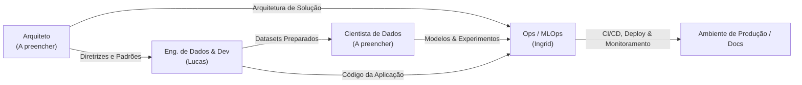

# RES-IA: Challenge 2

> **Residência em Inteligência Artificial — Grupo 08**  
> Documentação oficial e portal do projeto para o Challenge 2.

---

## Sobre o Challenge 2

O **Challenge 2** dá continuidade às atividades da **Residência Tecnológica em Inteligência Artificial (RES-IA)**. O foco deste desafio abrange a concepção, desenvolvimento, validação e implantação de uma solução orientada a IA, integrando governança de dados, engenharia de software de ponta a ponta e automação em nuvem (MLOps).

### Objetivos Principais
1. **Engenharia de Dados e Software Robusta**: Estruturação de pipelines de ingestão, sanitização e APIs escaláveis.
2. **Modelagem de IA & Ciência de Dados**: Experimentação, calibração e avaliação rigorosa de métricas.
3. **Arquitetura de Solução Escalável**: Desenho de sistemas modulares, desacoplados e de fácil manutenção.
4. **DevOps & MLOps**: Entrega contínua (CI/CD), rastreamento e versionamento de artefatos/modelos e monitoramento operacional.

---

## Divisão da Equipe (Grupo 08)

A distribuição inicial das responsabilidades dos integrantes está estruturada abaixo:

| Papel / Frente | Integrante | Responsabilidades e Foco Principal |
| :--- | :--- | :--- |
| **Engenheiro de Dados & Dev** | **Lucas** | Construção e ingestão de pipelines de dados, saneamento, desenvolvimento de serviços/APIs e integração da aplicação. |
| **Cientista de Dados** | *(a preencher)* | Formulação de hipóteses, modelagem estatística/aprendizado de máquina, análise exploratória e validação de métricas. |
| **Arquiteto** | *(a preencher)* | Definição de padrões arquiteturais, integração entre componentes, diagramação técnica e garantia de requisitos não-funcionais. |
| **Ops (DevOps & MLOps)** | **Ingrid** | Automação de CI/CD, esteiras de build/test/deploy, governança e versionamento de dados/modelos (DVC/MLflow) e infraestrutura em nuvem. |

---

## Fluxo de Colaboração entre as Frentes

---

## Navegação da Documentação

- **[Visão Geral do Desafio](desafio.md)**: Contexto aprofundado, objetivos e critérios de sucesso.
- **[Equipe e Atribuições](equipe.md)**: Detalhamento de cada papel e modelo de colaboração do time.
- **[Arquitetura e Engenharia](arquitetura.md)**: Espaço para documentação técnica de dados e backend.
- **[DevOps e MLOps](devops-mlops.md)**: Infraestrutura, esteiras de automação e governança.
- **[Metodologia](metodologia.md)**: Ritos ágeis (Scrum adaptado) e quadro de entregas.

---

## Links e Acessos Rápidos

- **Portal GitHub Pages:** [https://ingrdsoares.github.io/RES-IA-Challenge-2/](https://ingrdsoares.github.io/RES-IA-Challenge-2/)
- **Repositório do Projeto:** [https://github.com/ingrdsoares/RES-IA-Challenge-2](https://github.com/ingrdsoares/RES-IA-Challenge-2)
