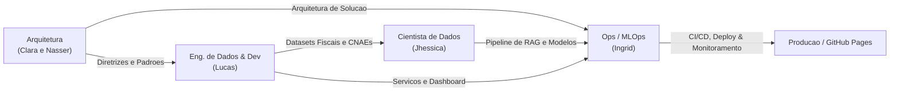

# Socio Digital: Copiloto de Gestao Fiscal para Pequenos Negocios

> **Desmistificando a contabilidade e a regularizacao de MEIs e MEs com IA**  
> **Residencia em Inteligencia Artificial (RES-IA) — Grupo 08**  
> Documentacao oficial e portal do projeto para o Challenge 2.

---

## Sobre o Projeto

O **Socio Digital** e um copiloto inteligente voltado para microempreendedores individuais (MEIs) e donos de microempresas (MEs). No Brasil, entre 95% e 99% das empresas ativas sao pequenos negocios cujos proprietarios nao tiveram acesso a educacao contabil e tributaria, tornando-se refens de uma "caixa preta" e vivendo sob o terror constante de multas fiscais.

A solucao recebe dados sobre a empresa (atividade, faturamento, regime e pendencias), esclarece obrigacoes fiscais em linguagem humana, sugere acoes praticas de regularizacao ou abertura e mantem um painel centralizado para acompanhamento continuo da saude fiscal do negocio.

---

## Divisao da Equipe (Grupo 08)

| Papel / Frente | Integrante | Responsabilidades e Foco Principal |
| :--- | :--- | :--- |
| **Engenheiro de Dados & Dev** | **Lucas** | Ingestao de dados fiscais (CNAEs, tabelas do Simples Nacional), desenvolvimento da API e painel de monitoramento. |
| **Cientista de Dados** | **Jhessica** | Modelagem do RAG factual com legislacao tributaria, extracao de entidades fiscais e avaliacao de fidelidade. |
| **Arquitetura de Solucoes** | **Clara e Nasser** | Topologia da arquitetura, contratos de servico, modelo de dados do painel e requisitos nao-funcionais. |
| **Ops (DevOps & MLOps)** | **Ingrid** | Esteiras de CI/CD, governanca de dados e modelos (DVC/MLflow), infraestrutura e automacao do GitHub Pages. |

---

## Fluxo de Colaboracao entre as Frentes

---

## Navegacao da Documentacao

- **[Pacote de Definicao do Projeto](definicao-projeto.md)**: Cenario, definicao do problema, stakeholders, personas, requisitos funcionais/nao-funcionais, riscos e metricas.
- **[Guiding Questions e Conceito](guiding-questions.md)**: Fundamentacao conceitual de qualidade de vida, analise das questoes norteadoras e fluxo consultivo sem diagnostico clinico/contabil.
- **[Arquitetura e Engenharia](arquitetura.md)**: Diretrizes de arquitetura (Clara e Nasser) e engenharia de dados/backend (Lucas).
- **[DevOps e MLOps](devops-mlops.md)**: Praticas de governanca, automacao de CI/CD e infraestrutura (Ingrid).
- **[Equipe e Atribuicoes](equipe.md)**: Detalhamento de cada papel e modelo de colaboracao.
- **[Metodologia e Entregas](metodologia.md)**: Scrum adaptado, git flow e criterios de aceitacao.
- **[Baixar Entregavel em PDF](entregaveis-challenge-2-grupo-08.pdf)**: Documento consolidado da semana com o nome de todos os integrantes.

---

## Links e Acessos Rapidos

- **Portal GitHub Pages:** [https://ingrdsoares.github.io/RES-IA-Challenge-2/](https://ingrdsoares.github.io/RES-IA-Challenge-2/)
- **Repositorio do Projeto:** [https://github.com/ingrdsoares/RES-IA-Challenge-2](https://github.com/ingrdsoares/RES-IA-Challenge-2)
