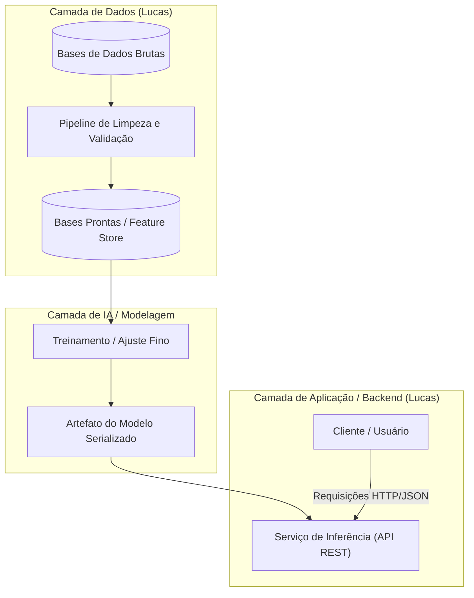

# Arquitetura e Engenharia de Dados

> **Frentes:** Arquiteto (a preencher) & Engenheiro de Dados / Dev (Lucas)  
> **Objetivo:** Estabelecer a topologia, os fluxos de dados e os contratos de serviço para a solução do Challenge 2.

---

## 🏗️ Visão Arquitetural Preliminar

A arquitetura do sistema é desenhada para garantir desacoplamento, reprodutibilidade e escalabilidade:

---

## 💻 Atuação da Engenharia de Dados e Dev (Lucas)

1. **Ingestão de Dados:**
   - Criação de scripts e módulos Python para carga dos dados de treino e teste.
   - Tratamento de valores ausentes, inconsistências e conformidade com esquemas pré-estabelecidos.

2. **Desenvolvimento da Aplicação:**
   - Estruturação do servidor da aplicação com validação estrita de esquemas (Pydantic / FastAPI).
   - Testes unitários para validar respostas das rotas e contratos de entrada e saída.

---

## 🏛️ Diretrizes de Arquitetura (A preencher)

- **Padrões de Projeto:** Módulos independentes com interfaces abstratas para algoritmos de IA, facilitando a substituição e comparação de modelos.
- **Segurança e Conformidade:** Não armazenamento de dados sensíveis não-anonimizados (LGPD).
- **Observabilidade:** Logs estruturados para facilitar auditoria e monitoramento de desempenho e erros.
