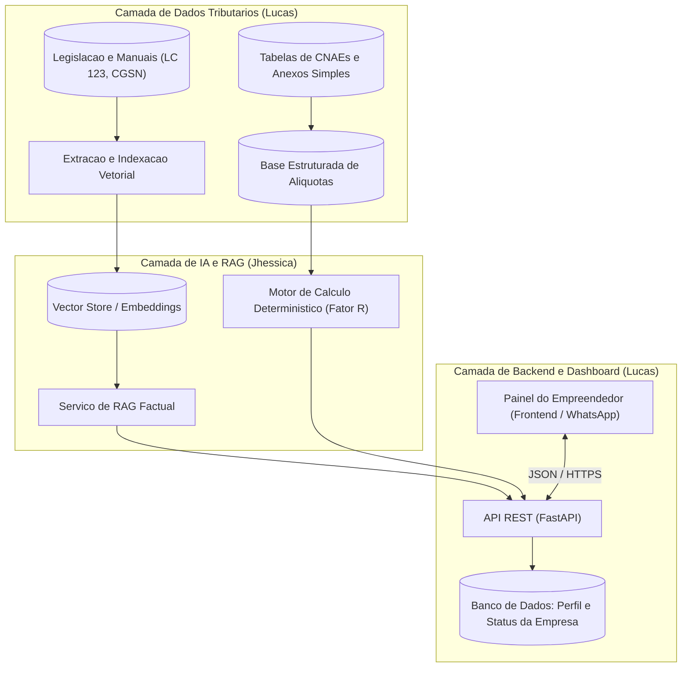

# Arquitetura e Engenharia de Dados - Socio Digital

> **Frentes:** Arquitetura (Clara e Nasser) & Engenharia de Dados / Dev (Lucas)  
> **Objetivo:** Estabelecer a topologia, os fluxos de dados, a persistencia do painel e os contratos de servico para a solucao do Socio Digital.

---

## Visao Arquitetural da Solucao

A arquitetura e projetada em camadas desacopladas, garantindo que o painel de monitoramento do usuario, o motor de RAG tributario e a base de conhecimento legal operem de forma modular:

---

## Atuacao da Engenharia de Dados e Dev (Lucas)

1. **Ingestao e Estruturacao de Dados Fiscais:**
   - Ingestao e saneamento da tabela oficial de CNAEs do IBGE e mapeamento de enquadramentos permitidos no Simples Nacional e MEI.
   - Construcao de scripts para alimentar o banco de dados com as tabelas de faixas de faturamento e deducoes dos Anexos I, II, III, IV e V da LC 123/2006.

2. **Backend e Persistencia da Empresa:**
   - Modelagem das entidades da empresa: CNPJ, atividade principal, faturamento historico e semaforo de conformidade.
   - Criacao das rotas de cadastro, simulacao de impostos e atualizacao do status do painel.
   - Testes unitarios rigorosos com `pytest` para certificar que os calculos de impostos e Fator R sejam 100% exatos.

---

## Diretrizes de Arquitetura (Clara e Nasser)

1. **Desacoplamento e Resiliencia:**
   - Separacao estrita entre a logica deterministica (calculo de aliquotas e deducoes matematicas) e a logica generativa do LLM (explicacoes acolhedoras e contextualizacao).
   - O LLM nunca faz contas matematicas "de cabeca"; ele delega o calculo para o motor deterministico de regras e apenas formata o resultado em linguagem didatica.

2. **Seguranca, Sigilo e LGPD:**
   - Isolamento de dados: nenhum dado financeiro ou societario sensivel da empresa do usuario e utilizado para retreinamento de modelos de terceiros.
   - Criptografia de dados sensiveis em repouso e em transito (HTTPS/TLS).

3. **Observabilidade e Auditoria:**
   - Rastreamento completo de chamadas com logs estruturados para auditoria tecnica de recomendacoes fiscais.
