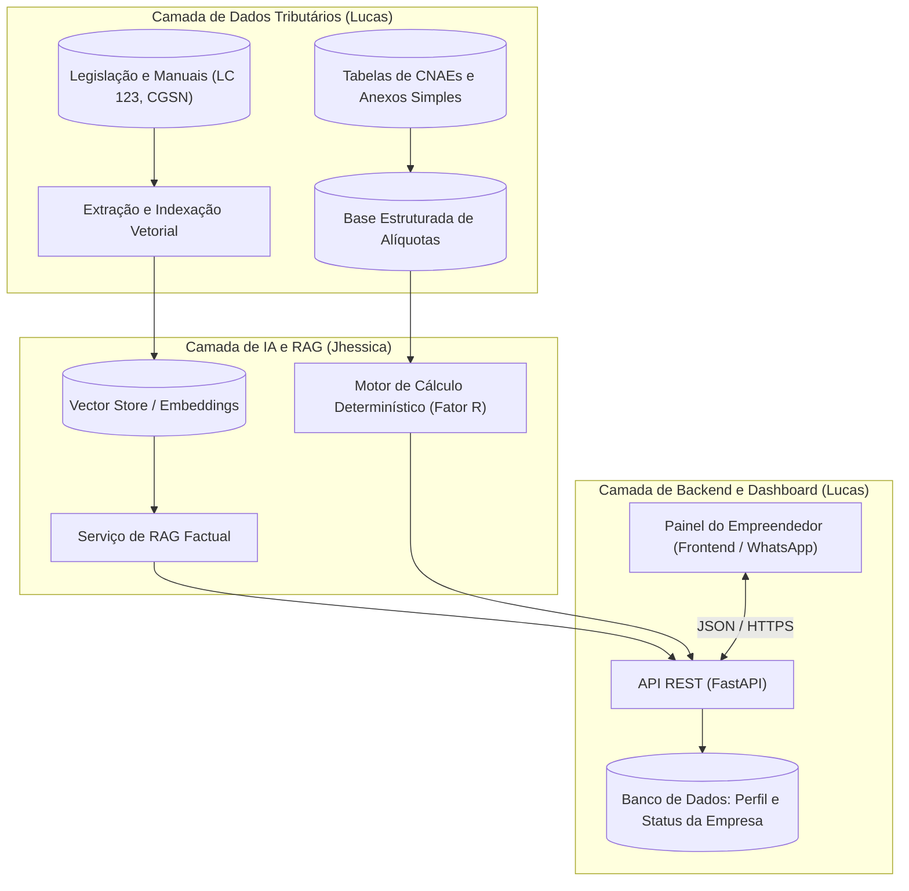

# Arquitetura e Engenharia de Dados — Sócio Digital

> **Frentes:** Arquitetura (Clara e Nasser) & Engenharia de Dados / Dev (Lucas)  
> **Objetivo:** Estabelecer a topologia, os fluxos de dados, a persistência do painel e os contratos de serviço para a solução do Sócio Digital.

---

## Visão Arquitetural da Solução

A arquitetura é projetada em camadas desacopladas, garantindo que o painel de monitoramento do usuário, o motor de RAG tributário e a base de conhecimento legal operem de forma modular:

---

## Arquitetura-alvo multiagente

Os diagramas apresentam a arquitetura proposta com um supervisor LLM e três agentes especializados: jurídico, diagnóstico fiscal e planejamento. A validação das respostas permanece em código e os cálculos ficam no motor determinístico.

- [Arquitetura geral multiagente — arquivo Excalidraw](diagramas/socio_digital_arquitetura.excalidraw): componentes, integrações e fluxo de delegação.
- [Backend multiagente — arquivo Excalidraw](diagramas/socio-digital-design-backend-2.excalidraw): módulos, fluxos, contratos e operação dos agentes.

Abra os arquivos em [excalidraw.com](https://excalidraw.com). Os desenhos representam a arquitetura-alvo; a execução multiagente, o frontend e as integrações fiscais ainda não estão implementados.

---

## Atuação da Engenharia de Dados e Dev (Lucas)

1. **Ingestão e Estruturação de Dados Fiscais:**
   - Ingestão e saneamento da tabela oficial de CNAEs do IBGE e mapeamento de enquadramentos permitidos no Simples Nacional e MEI.
   - Construção de scripts para alimentar o banco de dados com as tabelas de faixas de faturamento e deduções dos Anexos I, II, III, IV e V da LC 123/2006.

2. **Backend e Persistência da Empresa:**
   - Modelagem das entidades da empresa: CNPJ, atividade principal, faturamento histórico e semáforo de conformidade.
   - Criação das rotas de cadastro, simulação de impostos e atualização do status do painel.
   - Testes unitários rigorosos com `pytest` para certificar que os cálculos de impostos e Fator R sejam 100% exatos.

---

## Diretrizes de Arquitetura (Clara e Nasser)

1. **Desacoplamento e Resiliência:**
   - Separação estrita entre a lógica determinística (cálculo de alíquotas e deduções matemáticas) e a lógica generativa do LLM (explicações acolhedoras e contextualização).
   - O LLM nunca faz contas matemáticas de forma livre; ele delega o cálculo para o motor determinístico de regras e apenas formata o resultado em linguagem didática.

2. **Segurança, Sigilo e LGPD:**
   - Isolamento de dados: nenhum dado financeiro ou societário sensível da empresa do usuário é utilizado para retreinamento de modelos de terceiros.
   - Criptografia de dados sensíveis em repouso e em trânsito (HTTPS/TLS).

3. **Observabilidade e Auditoria:**
   - Rastreamento completo de chamadas com logs estruturados para auditoria técnica de recomendações fiscais.
