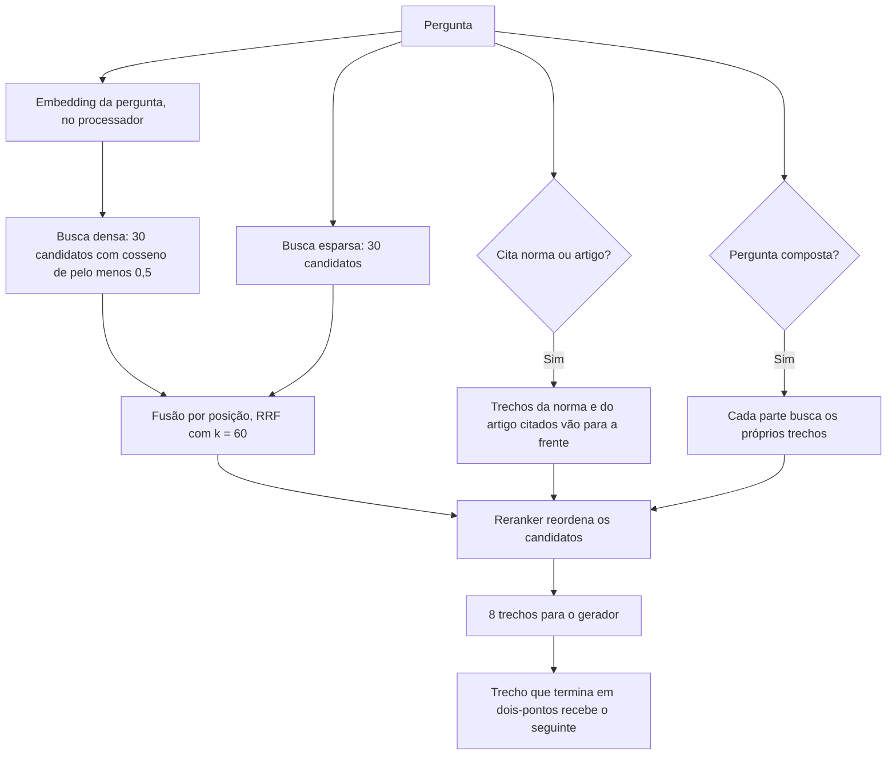

# Estratégia de Embeddings e Espaço Vetorial — Sócio Digital

> **Frente:** Ciência de Dados
> **Responsável:** Jhessica
> **Projeto:** Sócio Digital — RES-IA Challenge 2
> **Versão:** 3.0 (base `knowledge_base_v2`, 07/11/2026)
> **Status:** Implementada em `backend/api` (API FastAPI), `backend/reranker` e `src/rag/csv_para_qdrant.py`

---

## 1. Modelo de Embeddings

No início do projeto, um protótipo usava `sentence-transformers/paraphrase-multilingual-MiniLM-L12-v2` (384 dimensões), que captava mal as nuances do texto jurídico. A API usa:

$$\mathbf{Modelo:}\quad \text{qwen3-embedding:0.6b}$$

- **Dimensões:** 1024 (vetor denso).
- **Distância:** cosseno.
- **Execução:** local, pelo Ollama, na máquina com RTX 3080 Ti de 12 GB.
- **Gerador das respostas:** `qwen3:8b`, também pelo Ollama.

### Onde cada embedding é calculado

| Momento | Onde roda | Motivo |
|---|---|---|
| Carga dos trechos | Placa de vídeo, em lotes de 64 | Volume grande: 155.781 trechos |
| Pergunta do usuário | Processador | Uma pergunta leva cerca de 0,1 s; na placa, o modelo de embeddings ocuparia 2 GB que faltariam ao gerador |

O vetor da pergunta calculado no processador tem cosseno de pelo menos 0,999 em relação ao calculado na placa, então a troca não muda a busca.

### Instrução de consulta

O `qwen3-embedding:0.6b` é assimétrico: a pergunta recebe uma instrução de recuperação, e os trechos são indexados sem ela. Em `backend/api/app/models.py`:

```python
QUERY_INSTRUCTION = (
    "Instruct: Given a web search query, retrieve relevant passages that answer the query\nQuery:"
)
```

---

## 2. Coleção no Qdrant

A coleção `knowledge_base_v2` guarda dois vetores por trecho: o denso, do modelo de embeddings, e um esparso, de palavras exatas. A coleção anterior, `knowledge_base`, segue intacta para comparação.

```python
client.create_collection(
    collection_name="knowledge_base_v2",
    vectors_config={
        "dense": models.VectorParams(size=1024, distance=models.Distance.COSINE),
    },
    sparse_vectors_config={
        "sparse": models.SparseVectorParams(modifier=models.Modifier.IDF),
    },
)
```

A API se recusa a usar uma coleção sem os dois vetores ou com dimensão diferente de 1024.

### Vetor esparso (BM25)

Implementado em `backend/api/app/sparse.py`, sem dependência externa:

- **Normalização:** minúsculas e sem acento; números perdem a pontuação, para "43.982" casar com "43982".
- **Palavras vazias:** artigos, preposições e conjunções comuns são ignorados.
- **Pesos:** fórmula BM25 com k1 = 1,2 e b = 0,75, calculada na carga; o IDF fica a cargo do Qdrant.

O vetor esparso resolve o que o denso faz mal: números de norma, artigos e siglas, como "Decreto 43.982" ou "art. 13-A".

### Exemplo de ponto

```json
{
  "id": "uuid do trecho",
  "vector": {"dense": [0.0123, -0.0456, "..."], "sparse": {"indices": ["..."], "values": ["..."]}},
  "payload": {
    "text": "[DOCUMENTO: ... | FONTE: Lei Complementar nº 116, de 31 de julho de 2003 — ISS e lista de serviços | ARTIGO: Art. 7º]\nArt. 7º A base de cálculo do imposto é o preço do serviço. [...]",
    "source": "https://www2.camara.leg.br/legin/fed/leicom/2003/leicomplementar-116-31-julho-2003-492028-normaatualizada-pl.html",
    "title": "Lei Complementar nº 116, de 31 de julho de 2003 — ISS e lista de serviços",
    "document_id": "1e21025194b97af5...",
    "chunk_id": "lei_complementar_nº_116_de_31_de_julho_de_2003_iss_e_lista_de_serviços_art_7º",
    "norma": ["lc:116"],
    "artigo": "7",
    "ordem": 28,
    "frente": "legislacao",
    "natureza": "nao_informada"
  }
}
```

Os demais campos estão em `docs/arquitetura/estrategia-chunking.md`.

---

## 3. Busca



1. **Busca híbrida:** a densa e a esparsa trazem 30 candidatos cada, combinados pela posição em cada lista (RRF, k = 60). O `score` devolvido é sempre o cosseno real do vetor denso, e todo trecho precisa de cosseno de pelo menos 0,5, inclusive os que vieram só da esparsa. Assim, uma pergunta fora do acervo continua sem contexto em vez de receber trechos por coincidência de palavras.
2. **Norma e artigo citados:** se a pergunta cita uma norma ("LC 87") ou um artigo ("art. 23 da LC 87"), os melhores trechos dessa norma ou desse artigo entram na frente, mesmo longe da pergunta no espaço vetorial. Norma citada que não existe no acervo gera um aviso ao gerador.
3. **Perguntas compostas:** a pergunta é dividida por regra quando tem duas partes ("qual é a mínima e qual é a máxima?"). Cada parte busca e reordena os próprios trechos.
4. **Reordenação:** o modelo `BAAI/bge-reranker-v2-m3`, em contêiner próprio com placa de vídeo, avalia pergunta e trecho juntos e reordena os candidatos. Usa até 512 tokens por par, em lotes de 8, e ocupa cerca de 1,25 GB. Se ficar fora do ar ou demorar mais de 10 s, a busca segue com a ordem híbrida.
5. **Entrega:** os 8 primeiros trechos, sem repetição de conteúdo, até 12.000 caracteres, vão para o `qwen3:8b`, com contexto de 8.192 tokens.

### Efeito medido

Em 20 perguntas de desenvolvimento com fonte no acervo atual:

| Camada | Recall@5 | MRR@5 |
|---|---:|---:|
| Densa | 0,375 | 0,279 |
| Híbrida | 0,325 | 0,223 |
| Híbrida com norma citada | 0,375 | 0,323 |
| Reranker com norma citada | 0,400 | 0,473 |

A híbrida sozinha não supera a densa neste conjunto; o ganho vem da norma citada e do reranker. Testes completos em `docs/avaliacao/avaliacao-rag-2026-11-07.md`.

---

## 4. Limites de Memória

A placa de vídeo tem 12 GB e precisa acomodar o gerador, o reranker e o sistema. Com contexto de 16.384 tokens, a memória estourava e a leitura do prompt caía de cerca de 1.289 para 54 tokens por segundo. A configuração adotada usa contexto de 8.192 tokens e embedding da pergunta no processador, e fica perto de 10,8 GB.

---

## 5. Protótipo Anterior em `src/rag`

O protótipo em `src/rag` (índice em SQLite, fallback para MiniLM, TF-IDF e similaridade em Python puro, e expansão de consulta por entidades fiscais em `src/rag/entity_extractor.py`) não é usado pela API nem pela demonstração. O caminho oficial é o Qdrant com a API de `backend/api`.
