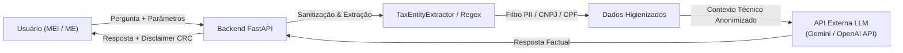

# Conformidade com a LGPD, Privacidade e Governança de Dados

> **Frente:** Ops (DevOps & MLOps — Ingrid Soares) e Arquitetura de Soluções (Clara e Nasser)  
> **Referência:** Issue E4.6 (Etapa 4: Produção — RES-IA Challenge 2)  
> **Status:** Concluído e Implementado  
> **Data:** Novembro de 2026  

---

## 1. Visão Geral e Contexto Regulatório

O **Sócio Digital** é um copiloto de inteligência artificial voltado ao letramento tributário e suporte consultivo a Microempreendedores Individuais (MEIs) e Micro e Pequenas Empresas (MPEs).

No ecossistema brasileiro de pequenos negócios, os dados corporativos possuem intersecção direta com dados pessoais protegidos pela **Lei Geral de Proteção de Dados (Lei nº 13.709/2018 — LGPD)**:
1. **Natureza Jurídica do MEI:** O Microempreendedor Individual confunde-se patrimonialmente com a pessoa física do empresário. Na prática da Receita Federal, o número base do CNPJ do MEI é derivado do CPF do titular, e o nome empresarial traz obrigatoriamente o nome civil do cidadão acrescido do CPF.
2. **Dados Financeiros e Tributários Sensíveis:** Valores de faturamento anual (RBT12), despesas com folha de pagamento, pró-labore e dívidas fiscais são dados sigilosos (sigilo fiscal e bancário) que não podem sofrer vazamento, indexação indevida ou cruzamento externo.

Este documento consolida a arquitetura de privacidade, a política de governança de dados, o mapeamento do tráfego para APIs de IA externas e os mecanismos automatizados de sanitização de logs.

---

## 2. Princípios da LGPD e Bases Legais Aplicadas

| Princípio da LGPD (Art. 6º) | Implementação no Sócio Digital |
| :--- | :--- |
| **Finalidade & Adequação** | Os dados coletados destinam-se exclusivamente à simulação de cenários do Simples Nacional/MEI e resposta a dúvidas legais do titular. |
| **Necessidade (Minimização)** | A inferência vetorial e o LLM não recebem nomes de sócios, senhas ou CPFs. Apenas CNAEs, valores anonimizados e trechos de normas são processados. |
| **Livre Acesso & Transparência** | O usuário visualiza com clareza quais parâmetros foram utilizados em cada diagnóstico (ex: cálculo do Fator R) e quais artigos de lei fundamentaram a resposta. |
| **Segurança & Prevenção** | Criptografia em trânsito (HTTPS/TLS com HSTS obrigatório), criptografia em repouso nos bancos (PostgreSQL/Qdrant) e isolamento multi-tenant por empresa. |
| **Não Discriminação** | Os algoritmos de recomendação tributária são determinísticos e auditáveis (baseados na LC 123/2006), sem perfilamento discriminatório ou scoring de crédito. |

### Bases Legais de Tratamento (Art. 7º da LGPD)
* **Art. 7º, I (Consentimento):** Coletado explicitamente no aceite dos Termos de Uso e Política de Privacidade durante o cadastro de perfil.
* **Art. 7º, V (Execução de Contrato):** O processamento de dados fiscais é necessário para a prestação do serviço consultivo contratado pelo usuário.
* **Art. 7º, IX (Legítimo Interesse):** Utilização de métricas agregadas e dados desidentificados para aprimoramento da fidelidade do copiloto e detecção de regressões de qualidade na esteira de MLOps.

---

## 3. Mapeamento de Dados e Tráfego para Provedores de IA (LLMs)

Uma das maiores preocupações de conformidade em aplicações com LLM é o risco de vazamento de segredos comerciais ou PII para nuvens de terceiros.

Conforme deliberado na [ADR 001](adr-001-hospedagem-e-custo-ia.md), o Sócio Digital utiliza provedores gerenciados de alta eficiência (Google Gemini Flash / OpenAI GPT-4o-mini). A conformidade de privacidade é assegurada pela seguinte esteira de isolamento:

### Regras Estritas de Envio ao Modelo Externo
1. **Zero PII no Prompt:** Nenhum CPF, nome completo, endereço, telefone ou e-mail de titular é concatenado ao prompt enviado à API de LLM.
2. **Minimização Tributária:** Se o usuário pergunta *"Como calcular o Simples da minha empresa de software que fatura 300k com folha de 90k?"*, o extrator de entidades extrai apenas `CNAE: 6201-5/01, Fator R: 0.30, Anexo: III`. O modelo de IA recebe apenas a solicitação de formatação explicativa do plano de 3 passos.
3. **Cláusula de Não Treinamento (Zero-Retention Training):** A contratação e uso das APIs corporativas (Google Vertex AI / Gemini API corporativa / OpenAI API) garantem formalmente por contrato de enterprise que as requisições de inferência não são utilizadas para alimentar o treinamento contínuo de modelos públicos dos provedores.

---

## 4. Higienização e Sanitização Automática de Logs (Ops/MLOps)

Para garantir que desenvolvedores, ferramentas de observabilidade (Datadog, Grafana, CloudWatch) e logs em disco nunca exponham dados pessoais ou segredos operacionais, foi implementado o módulo [`app.sanitizer`](../../backend/api/app/sanitizer.py):

* **Filtros por Expressão Regular:**
  * **CPF:** `\b\d{3}\.?\d{3}\.?\d{3}-?\d{2}\b` $\rightarrow$ `[CPF REDIGIDO]`
  * **CNPJ:** `\b\d{2}\.?\d{3}\.?\d{3}/?\d{4}-?\d{2}\b` $\rightarrow$ `[CNPJ REDIGIDO]`
  * **E-mail:** Expressão canônica RFC 5322 $\rightarrow$ `[EMAIL REDIGIDO]`
  * **Telefone:** Padrões DDD + 8/9 dígitos $\rightarrow$ `[TELEFONE REDIGIDO]`
  * **Tokens de Autenticação:** `Bearer ...` $\rightarrow$ `Bearer [TOKEN REDIGIDO]`
* **Chaves Sensíveis de Payload:** Chaves de dicionário contendo `password`, `secret`, `token`, `auth`, `cpf`, `cnpj` têm seus valores mascarados para `[CONFIDENCIAL]` antes de qualquer serialização.
* **`LGPDSanitizingFormatter`:** Formatador de logging nativo integrado ao runtime da FastAPI que atua no nível do interceptor de stdout, impedindo vazamentos até mesmo em caso de exceções não tratadas (*unhandled tracebacks*).

---

## 5. Rastreabilidade com Request ID (`X-Request-ID`)

Para auditoria sem violação de privacidade, a API implementa o cabeçalho `X-Request-ID`:
* Cada requisição HTTP recebe um identificador único (UUIDv4) injetado pelo middleware.
* O identificador é retornado no cabeçalho HTTP de resposta ao cliente e associado aos logs estruturados.
* Em caso de reporte de incidente ou auditoria, a requisição pode ser investigada no sistema pelo `Request ID` sem necessidade de pesquisar ou expor o conteúdo sensível da mensagem do usuário.

---

## 6. Direitos dos Titulares e Fluxo de Exclusão (Right to be Forgotten)

Em cumprimento ao Art. 18 da LGPD, o Sócio Digital disponibiliza os seguintes mecanismos:
1. **Confirmação e Acesso (Art. 18, I e II):** O usuário pode visualizar a qualquer momento todas as empresas cadastradas, diagnósticos salvos e parâmetros fiscais armazenados.
2. **Correção de Dados (Art. 18, III):** Edição imediata de alíquotas, CNAEs secundários e dados cadastrais via interface ou API.
3. **Exclusão de Conta e Eliminação de Dados (Art. 18, VI):**
   * Endpoint dedicado `DELETE /access/account` com confirmação autenticada.
   * Realiza o *hard delete* de credenciais criptografadas e dados de empresas associadas no banco relacional PostgreSQL.
   * Purga vetores isolados do tenant no Qdrant (caso o usuário tenha criado coleções particulares de documentos).
   * Backups automatizados são rotacionados em até 30 dias com descarte criptográfico seguro.
