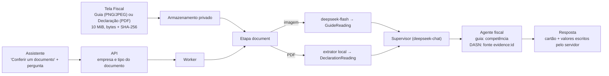

# Assistente de IA Multimodal: Modalidades Suportadas, Limitações e Mitigações

**Projeto:** Sócio Digital — Inteligência Fiscal para Microempreendedores  
**Programa:** Residência Tecnológica em IA (RES-IA) — Instituto Eldorado / UnB (Turma 2)  
**Desafio:** Challenge 2 — Grupo 08  
**Atualizado em:** 25/11/2026, conferido contra o código e com execução real  
**Documento de entrega:** [entrega-assistente-multimodal-2026-11-25.pdf](../entrega/entrega-assistente-multimodal-2026-11-25.pdf)

---

## 1. Resumo

O Assistente processa **texto**, **imagem** (guia DAS em PNG/JPEG) e **PDF** (DASN-SIMEI) de ponta a ponta. O usuário escolhe um documento cadastrado na tela Fiscal, escreve a pergunta e a resposta usa o que foi lido. Os modelos de linguagem são todos da DeepSeek: `deepseek-flash` (multimodal) lê a imagem e `deepseek-chat` roda os agentes. O PDF é lido por um extrator determinístico no servidor, sem modelo e sem envio externo.

| Modalidade | Leitor | Onde está |
|---|---|---|
| Texto | `deepseek-chat` (supervisor, fiscal, planejamento, síntese) | `backend/api/app/assistant/agents/executor.py` |
| Imagem PNG/JPEG (guia DAS) | `deepseek-flash`, contrato `GuideReading` | `app/assistant/agents/guide_vision.py`; ligada por `GUIDE_VISION_ENABLED` |
| PDF (DASN-SIMEI) | Extrator local (`pypdf` + regras), contrato `DeclarationReading` | `app/assistant/agents/declaration.py` sobre `app/assistant/multimodal/pdf_parser.py` |
| Áudio, vídeo | Não suportado | — |

## 2. Como os dados lidos viram resposta

| Situação | Resultado |
|---|---|
| Guia, pergunta só sobre ela | Sem especialistas; cartão "Dados lidos na guia"; "O pagamento não foi verificado." |
| Guia, pagamento ou cálculo | A competência lida vira o período do agente fiscal. |
| Guia, mês diferente na pergunta | Pausa para confirmar a competência; leitura reaproveitada na retomada. |
| DASN, pergunta só sobre ela | Sem especialistas; cartão "Dados lidos na declaração". |
| DASN, limite ou desenquadramento | Agente fiscal recebe os dados como fonte `evidence:<id>` e a cita; o servidor escreve "Declaração DASN-SIMEI de 2025: receita bruta de R$ 92.000,00, acima do limite anual de R$ 81.000,00 (excesso de R$ 11.000,00, 13,58%). Excesso de até 20%: desenquadramento a partir de 01/01/2026." |
| Documento ilegível | Campos `null` ou `legible=false`; a resposta pede uma imagem mais nítida ou o PDF original. |

Valores fiscais nunca são publicados a partir do texto livre do modelo: cartões e a linha da DASN vêm dos contratos validados.

## 3. Medições de 25/11/2026

**Fluxo completo real** (API, worker, Postgres, Redis, armazenamento e DeepSeek):

| Pergunta | Etapas | Total |
|---|---|---|
| Guia: "Qual a competência e o valor desta guia?" | document (deepseek-flash, 607 + 24 tokens) → plan | 6,2 s |
| DASN: "O que diz esta declaração?" | document (extrator, 10 ms) → plan | 4,2 s |
| DASN: "…ultrapassou o limite do MEI?" | document → plan → fiscal (citou a declaração) → synthesis | 8,1 s |

**Imagem isolada**: 9 chamadas de `read_guide` sobre `docs/media/das-ficticio.png` e variações, todas com o comportamento esperado: original (3×), JPEG 40 e girada lidas corretamente; instrução maliciosa na imagem ignorada; valor coberto devolvido como `null`; imagem borrada e imagem que não é guia com todos os campos `null`. Total de 5.833 + 198 tokens, mediana de 1,52 s.

**PDF isolado**: 34 de 34 campos iguais a `data/benchmark/multimodal/metadados_esperados.json` nos dois arquivos de teste, em 10 a 43 ms.

## 4. Limitações conhecidas

| # | Modalidade | Limitação | Consequência |
|---|---|---|---|
| L1 | Imagem | Só competência, vencimento e valor | CNPJ e código de barras não são lidos. |
| L2 | Imagem | A imagem inteira vai para a DeepSeek | Sem recorte nem anonimização; leitura desligada por padrão e aviso na tela. |
| L3 | Imagem | Só PNG e JPEG, uma guia por mensagem | Guia em PDF não é lida. |
| L4 | Imagem | Valor e vencimento não chegam aos especialistas | O agente fiscal recebe só a competência. |
| L5 | Imagem | Avaliação com 1 guia fictícia e 8 variações | Não há conjunto de guias reais com gabarito. |
| L6 | Imagem | Modelo de visão fixo no código | Trocar o modelo exige mudança de código. |
| L7 | PDF | Regras feitas para o layout dos arquivos de teste | Uma DASN real do portal pode não ser reconhecida; a resposta pede o PDF original. |
| L8 | PDF | Depende da camada de texto | PDF digitalizado não é lido nem convertido em imagem. |
| L9 | PDF | Só DASN-SIMEI | Outros PDFs fiscais não são interpretados. |
| L10 | PDF | Vários anos no mesmo arquivo | Lê o primeiro recibo; sem validação cruzada com o ano da pergunta. |

## 5. Casos de falha e mitigação

| Caso | Mitigação implementada | Evidência |
|---|---|---|
| Imagem ilegível | Campos `null`; resposta pede imagem mais nítida | Medição (borrada) |
| Imagem que não é DAS | Prompt manda devolver tudo `null` | Medição (print do app) |
| Campo coberto ou ausente | Só aquele campo `null`; cartão mostra "Ilegível ou ausente" | Medição; e2e |
| Instrução escrita na imagem | Prompt trata instruções como conteúdo; contrato fechado | Medição (instrução maliciosa) |
| JSON fora do contrato | `invalid_agent_result`, nada publicado | `tests/test_guide_vision.py` |
| DeepSeek indisponível ou sem crédito | `dependency_unavailable`, até 2 tentativas; erro sem o corpo do provedor | `tests/test_guide_vision.py`; e2e |
| PDF que não é DASN ou layout desconhecido | `legible=false`; resposta pede o PDF original | `tests/mvp/test_declaration_messages.py`; e2e |
| PDF corrompido ou com senha | Extrator devolve documento desconhecido sem quebrar | `tests/test_declaration_reading.py`; verificação manual |
| Agente fiscal escreve valor diferente do lido | Texto do agente não é publicado; o servidor escreve a linha da DASN | `tests/test_agent_validation.py` |
| Documento de outra empresa | API recusa (404) antes da leitura; worker reconfere | `tests/mvp/test_guide_messages.py` |
| Arquivo trocado após o cadastro | Anexo imutável (409); worker confere assinatura e SHA-256 | `tests/mvp/test_guide_messages.py` |
| Tipo errado | Guia exige PNG/JPEG e declaração exige PDF (422); 413 acima de 10 MiB | `tests/mvp/test_guide_messages.py` |
| Mês da pergunta ≠ mês da guia | Pausa para confirmar; leitura reaproveitada | `tests/mvp/test_guide_messages.py`; e2e |
| Leitura de imagem desligada | 503 para guia; declarações seguem disponíveis | `tests/mvp/test_declaration_messages.py`; e2e |
| Afirmar pagamento a partir do documento | Pagamento só com comprovante | `tests/mvp/test_guide_messages.py` |

## 6. Testes

| Suíte | Casos | Precisa de serviços |
|---|---|---|
| `backend/api/tests/test_guide_vision.py` | 10 | Não |
| `backend/api/tests/test_declaration_reading.py` | 3 | Não |
| `backend/api/tests/test_agent_validation.py` | 10 | Não |
| `backend/api/tests/test_assistant_multimodal.py` | 6 | Não |
| `backend/api/tests/mvp/test_guide_messages.py` | 5 | Postgres |
| `backend/api/tests/mvp/test_declaration_messages.py` | 4 | Postgres |
| `frontend/e2e/assistente.pw.ts` (guia e declaração) | 7 | Não (API simulada) |

## 7. Próximos passos

1. Ajustar o extrator com DASN reais do portal, anonimizadas.
2. PDF digitalizado: converter a página em imagem e ler com o `deepseek-flash`.
3. Ler CNPJ (conferido com a empresa ativa) e código de barras da guia.
4. Montar um conjunto de guias reais com gabarito.
