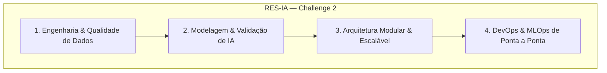

# Visão Geral do Challenge 2

A Residência em Inteligência Artificial (RES-IA) propõe o **Challenge 2** como uma etapa avançada de consolidação e evolução de competências práticas em soluções de Inteligência Artificial aplicada.

---

## 📌 Contexto e Propósito

Após a conclusão das fases preliminares, o **Challenge 2** eleva a complexidade técnica e a exigência de integração entre diferentes disciplinas da computação e da ciência de dados:

1. **Ciclo de Vida Completo de Machine Learning**: Da exploração de dados à inferência em produção.
2. **Qualidade e Resiliência**: Testes de regressão, monitoramento de drift e rastreabilidade estrita.
3. **Colaboração Multidisciplinar**: Atuação coordenada entre Engenharia de Dados, Ciência de Dados, Arquitetura de Software e DevOps/MLOps.

---

## 🎯 Pilares Técnicos

### 1. Dados
- Ingestão contínua e garantia de qualidade de dados (Data Quality).
- Catalogação, versionamento e linhagem de dados para auditoria.

### 2. Modelagem
- Abordagens baseline seguidas por modelos estado-da-arte adequados ao problema de negócio.
- Critérios objetivos de Go/No-Go baseados em métricas claras.

### 3. Arquitetura
- Separação em camadas bem definidas (apresentação, serviços de inferência, persistência).
- Padrões de resiliência e contratos claros de API (OpenAPI/Swagger).

### 4. MLOps e Automação
- Pipelines reprodutíveis via containers (Docker).
- Automação de deploy contínuo e monitoramento da integridade dos modelos.

---

## 📅 Marcos e Entregas

| Fase | Descrição | Principais Frentes Envolvidas |
| :--- | :--- | :--- |
| **Fase 1: Setup & Alinhamento** | Configuração do repositório, documentação inicial (GitHub Pages), definição de papéis. | Todas (Liderado por Ops e Arquiteto) |
| **Fase 2: Dados e Baselines** | Pipelines de pré-processamento, primeiros benchmarks do classificador/modelo. | Engenharia de Dados e Ciência de Dados |
| **Fase 3: Integração & Serviços** | Construção das APIs, esteira de CI com testes e métricas no GitHub Actions. | Dev, Ops e Arquitetura |
| **Fase 4: Validação & Go/No-Go** | Avaliação final dos modelos, esteira de deploy e entrega técnica. | Todas as frentes |
