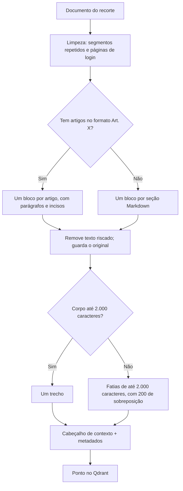

# Estratégia de Chunking Hierárquico Jurídico — Sócio Digital

> **Frente:** Ciência de Dados
> **Responsável:** Jhessica
> **Projeto:** Sócio Digital — RES-IA Challenge 2
> **Versão:** 3.0 (base `knowledge_base_v2`, 07/11/2026)
> **Status:** Implementada em `src/rag/chunker.py` e `src/rag/csv_para_qdrant.py`

---

## 1. Contexto e Motivação do Chunking Especializado

Na área tributária e legislativa brasileira, o **"chunking ingênuo"** (divisão cega por contagem de caracteres ou quebras de parágrafo) acarreta falhas na recuperação e na fundamentação das respostas:

1. **Fracionamento de dispositivos legais:** um parágrafo (§) ou inciso desvinculado do seu caput perde o sujeito jurídico.
2. **Perda de contexto hierárquico:** um trecho que diz apenas *"na hipótese de não ter ultrapassado em mais de 20%"* não informa se a regra é do MEI, do Simples Nacional ou de outro tributo.
3. **Cortes de tabelas e listas:** faixas de faturamento, alíquotas e listas de incisos precisam ficar íntegras sempre que possível.

Para isso, usamos o **LegalHierarchicalChunker**, que segmenta por artigo e injeta no início de cada trecho o contexto da norma.

---

## 2. Parâmetros de Segmentação

| Parâmetro | Valor | Justificativa |
|---|---|---|
| **Unidade principal** | Artigo, com seus parágrafos e incisos | Mantém caput, parágrafos e incisos juntos sempre que cabem no limite |
| **Tamanho máximo do corpo** | **2.000 caracteres** | Cabe com folga no contexto do `qwen3:8b`, que recebe até 8 trechos e 12.000 caracteres por pergunta |
| **Sobreposição** | **200 caracteres** | Continuidade entre fatias quando um artigo ou seção ultrapassa o limite |
| **Cabeçalho de contexto** | Obrigatório | Norma, capítulo, artigo e tema no início de cada trecho |
| **Documentos sem artigos** | Divisão por seções Markdown | Manuais, perguntas frequentes, consultas e acórdãos |

---

## 3. Limpeza antes da Segmentação

Antes de fatiar, o texto coletado passa por limpezas que não alteram o conteúdo normativo:

- **Cabeçalhos de segmento repetidos:** as marcas `## Segmento N — versão M` do refino e os segmentos idênticos repetidos no mesmo documento são removidos. Antes da limpeza, quase metade dos trechos tinha esses cabeçalhos.
- **Texto riscado:** trechos tachados (revogados ou alterados na fonte) saem do texto usado para busca. O original com as marcas fica guardado no campo `texto_com_rasuras`. Trecho totalmente riscado, ou que sobra só com o número do artigo, não é indexado.
- **Rótulo de artigo:** só conta como início de artigo a forma `Art.` ou `ART.` em início de linha. Uma citação como "art. 8º da LC 87" dentro do texto não abre artigo novo.
- **Páginas sem conteúdo:** as 11 páginas de login do CARF coletadas no lugar de súmulas são descartadas na carga.

---

## 4. Cabeçalho de Contexto

Todo trecho recebe um cabeçalho antes do corpo. Ele orienta o embedding e diz ao modelo de linguagem de onde o texto veio. Exemplo real da coleção:

```text
[DOCUMENTO: lei_complementar_nº_116_de_31_de_julho_de_2003_iss_e_lista_de_serviços | FONTE: Lei Complementar nº 116, de 31 de julho de 2003 — ISS e lista de serviços | CAPÍTULO: Geral | ARTIGO: Art. 7º | TEMA: Art. 7º]
Art.
7º A base de cálculo do imposto é o preço do serviço.

§
1º Quando os serviços descritos pelo subitem 3.04 da lista anexa
forem prestados no território de mais de um Município, a base de
cálculo será proporcional [...]
```

### Vantagens do cabeçalho
- **Busca por norma e artigo:** perguntas como *"o que diz o art. 7º da LC 116"* encontram o trecho pelos termos do cabeçalho.
- **Rastreabilidade:** a rota `/rag/query` devolve `source`, `title`, `document_id`, `chunk_id` e `score` de cada trecho usado.
- **Atribuição correta:** o modelo cita a norma pelo título do documento, e não por uma norma apenas mencionada no texto.

---

## 5. Fluxo de Decisão



---

## 6. Metadados de Cada Trecho

| Campo | Conteúdo | Uso |
|---|---|---|
| `text` | Cabeçalho e corpo do trecho | Texto entregue ao modelo |
| `title`, `source` | Título e endereço de origem do documento | Citação da fonte |
| `document_id`, `chunk_id` | Identificadores do documento e do trecho | Rastreabilidade |
| `norma` | Chave da norma, como `lc:116` ou `decreto:43982` | Busca da norma citada na pergunta |
| `artigo` | Número do artigo, como `7` ou `13-a` | Busca direta do artigo citado |
| `ordem` | Posição do trecho no documento | Completar trecho cortado com o seguinte |
| `frente`, `natureza` | Frente de coleta e tipo de documento | Análise e filtros |
| `texto_com_rasuras` | Original com texto riscado, quando houver | Conferência |

Quando um trecho escolhido termina em dois-pontos, como "nos seguintes termos:", a API acrescenta o trecho seguinte do mesmo documento, usando o campo `ordem`. Isso acontece em cerca de 5% dos trechos.

---

## 7. Resultados na Base Atual

Fatiamento de toda a base `knowledge_base_v2`:

| Indicador | Valor |
|---|---:|
| Documentos | 4.026 |
| Trechos indexados | 155.781 |
| Trechos com artigo identificado | 112.711 (72%) |
| Trechos em que texto riscado foi removido | 11.569 |
| Trechos descartados por estarem totalmente riscados | 69 |
| Tamanho médio, com cabeçalho | 1.263 caracteres |
| Mediana | 1.295 caracteres |
| 95% dos trechos até | 1.972 caracteres |
| Maior trecho, com cabeçalho | 2.200 caracteres |

O corpo nunca passa de 2.000 caracteres; os valores acima incluem o cabeçalho. A base anterior, `knowledge_base`, tinha 176.529 trechos; a diferença vem sobretudo da remoção de segmentos repetidos.

O efeito na recuperação e nas respostas está em `docs/avaliacao-rag-2026-11-07.md`.
