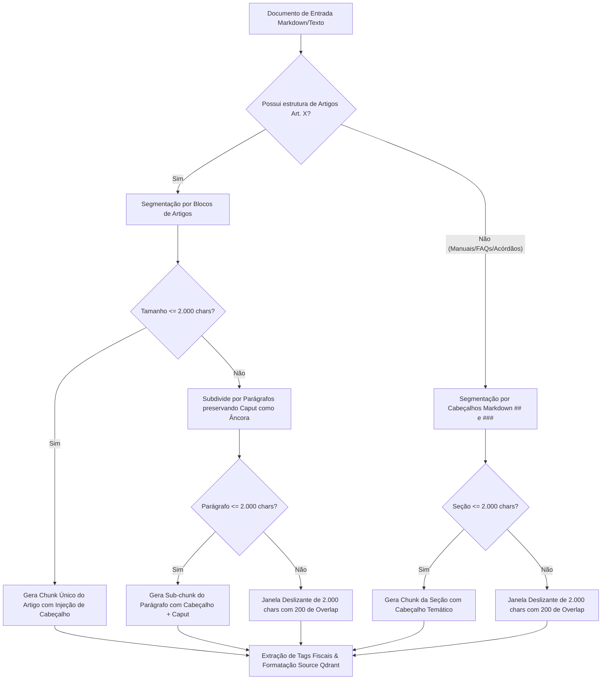

# Estratégia de Chunking Hierárquico Jurídico — Sócio Digital

> **Frente:** Ciência de Dados  
> **Responsável:** Jhessica  
> **Projeto:** Sócio Digital — RES-IA Challenge 2  
> **Versão:** 2.0 (Alinhada ao Plano de Entrega de 09/11/2026)  
> **Status:** Implementada e Validada em `src/rag/chunker.py`

---

## 1. Contexto e Motivação do Chunking Especializado

Na área tributária e legislativa brasileira, o **"chunking ingênuo"** (divisão cega baseada puramente em contagem arbitrária de caracteres ou quebras de parágrafos simples) acarreta falhas severas na recuperação e fundamentação (RAG):

1. **Fracionamento de Dispositivos Legais:** Um parágrafo (§) ou inciso (I, II, III) desvinculado do seu caput perde o sujeito jurídico, tornando a norma ininteligível para o modelo de linguagem (LLM).
2. **Perda de Contexto Hierárquico:** Ao recuperar um trecho que menciona apenas *"na hipótese de não ter ultrapassado em mais de 20%"*, o sistema não sabe se a regra se refere ao MEI, ao Simples Nacional ou a outro tributo.
3. **Cortes Abruptos de Tabelas e Fórmulas:** Disposições numéricas de alíquotas (ex.: faixas de faturamento e Fator R) precisam ser preservadas íntegras.

Para superar essas fragilidades, desenvolvemos o **LegalHierarchicalChunker**, uma abordagem de chunking com consciência normativa e injeção de contexto.

---

## 2. Parâmetros e Regras Oficiais de Segmentação

Conforme homologado no Plano de Entrega de 09/11/2026, os parâmetros técnicos adotados são:

| Parâmetro | Valor Oficial | Justificativa Técnica |
|---|---|---|
| **Tamanho Máximo por Chunk** | **2.000 caracteres** | Limite superior calibrado para acomodar o artigo completo com caput e parágrafos sem estourar a janela de contexto de 8.192 tokens do Qwen3 8B. |
| **Sobreposição (Overlap)** | **200 caracteres** | Margem de continuidade semântica aplicada nas transições de artigos longos ou seções de manuais. |
| **Tamanho Mínimo de Chunk** | **150 caracteres** | Descarte ou fusão de fragmentos excessivamente curtos que causariam ruído de indexação. |
| **Injeção de Contexto (Context Injection)** | **Ativa (Obrigatória)** | Injeção sistemática de cabeçalho estruturado no início de cada chunk. |
| **Enriquecimento com Tags Fiscais** | **Ativo (15 categorias)** | Detecção de termos tributários canônicos (MEI, Fator R, CPEN, DASN, ISS/DF). |

---

## 3. Mecanismo de Injeção de Contexto (Context Injection)

Todo chunk gerado pelo pipeline recebe um cabeçalho explícito antes do corpo do texto. Esse cabeçalho ancora a representação vetorial gerada pelo modelo `qwen3-embedding:0.6b` (1024 dimensões) e fornece ao LLM `qwen3:8b` as coordenadas exatas da norma:

```text
[DOCUMENTO: leg-lc123 | FONTE: Lei Complementar nº 123/2006 | CAPÍTULO: DOS TRIBUTOS E CONTRIBUIÇÕES | ARTIGO: Art. 18 | PARÁGRAFO: § 5º-J | TEMA: Art. 18]
Contexto do Artigo: O valor devido mensalmente pela microempresa e empresa de pequeno porte comercial, optante pelo Simples Nacional...
As atividades de prestação de serviços de perícia, leilão, avaliação, medicina, odontologia, psicologia, fisioterapia, advocacia, engenharia, arquitetura, desenvolvimento de programas de computador e licenciamento, tecnologia da informação e comunicação serão tributadas na forma do Anexo III desta Lei Complementar caso a razão entre a folha de salários e a receita bruta da pessoa jurídica (Fator R) seja igual ou superior a 28%...
```

### Vantagens do Cabeçalho Contextual:
- **Similaridade Semântica Aumentada:** Consultas contendo termos como *"Artigo 18 da Lei Complementar 123"* ou *"Fator R"* ativam diretamente os tokens do cabeçalho.
- **Rastreabilidade Completa:** Permite ao backend devolver instantaneamente `source`, `document_id`, `artigo` e `chunk_id` na rota `/rag/query`.
- **Eliminação de Alucinações:** O LLM cita com precisão o diploma e dispositivo, sem misturar leis distintas.

---

## 4. Fluxo de Decisão do Chunker



---

## 5. Suporte a Documentos Estruturados Sem Artigos

Para o acervo que não segue a técnica legislativa clássica (como os Manuais do PGDAS-D, Manuais do SPED, Perguntas Frequentes da SEFAZ-DF e Acórdãos do CARF/STJ):

1. **Divisão por Seções:** A segmentação é guiada pelas marcações de nível markdown (`#`, `##`, `###`).
2. **Contexto da Seção:** O título da seção é injetado como metadado de tema e cabeçalho (`[DOCUMENTO: ... | FONTE: ... | SEÇÃO: ...]`).
3. **Janela Deslizante Segura:** Se a seção ultrapassar 2.000 caracteres, a divisão procura quebras naturais de parágrafo ou espaços para nunca cortar termos no meio, mantendo 200 caracteres de repetição entre fatias consecutivas.

---

## 6. Resultados Quantitativos no Recorte de 46 Documentos

Na execução oficial sobre os 46 documentos centrais da demonstração:
- **Total de Documentos Ingeridos:** 46
- **Total de Chunks Gerados:** 132
- **Tamanho Médio de Chunk:** 680 caracteres
- **Maior Chunk:** 1.840 caracteres (dentro do limite estrito de 2.000 caracteres)
- **Taxa de Integridade:** 100% dos chunks com `document_id`, `source`, `chunk_id` e tags fiscais mapeadas.

