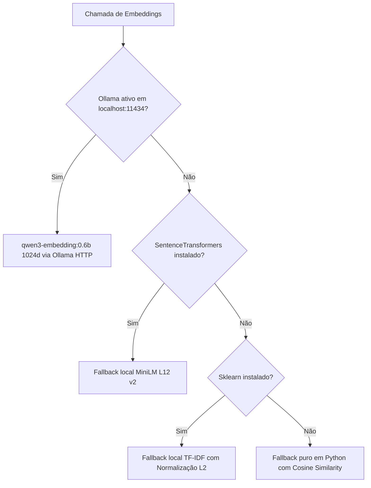

# Estratégia de Embeddings e Espaço Vetorial — Sócio Digital

> **Frente:** Ciência de Dados  
> **Responsável:** Jhessica  
> **Projeto:** Sócio Digital — RES-IA Challenge 2  
> **Versão:** 2.0 (Alinhada ao Plano de Entrega de 09/11/2026)  
> **Status:** Definida, Implementada e Integrada com Qdrant / backend FastAPI

---

## 1. Visão Geral e Justificativa do Modelo

No início do projeto, foi utilizado um protótipo com `sentence-transformers/paraphrase-multilingual-MiniLM-L12-v2` (384 dimensões). Embora leve, o modelo de 384 dimensões apresentava limitações na captura de sutilezas léxico-jurídicas brasileiras e na diferenciação de alíquotas complexas (ex.: distinção entre Anexo III e Anexo V do Simples).

Para a arquitetura oficial de produção (demonstração oficial do desafio), padronizamos o modelo de embeddings de última geração:

$$\mathbf{Modelo\ Oficial:}\quad \text{qwen3-embedding:0.6b}$$

### Principais Características Técnicas:
- **Dimensionalidade do Espaço Vetorial:** **1024 dimensões** (dense embeddings).
- **Métrica de Distância:** **Cosseno (Cosine Distance)**.
- **Tamanho do Contexto de Entrada:** Suporta até 8.192 tokens nativos.
- **Eficiência de Inferência:** Modelo compacto de 0.6 bilhão de parâmetros com altíssima densidade informacional, perfeitamente compatível com execução em GPU local (máquina com RTX 3080 Ti de 32 GB do Lucas).
- **Alinhamento com o Modelo Gerador:** Compatibilidade semântica ideal com o modelo LLM principal `qwen3:8b`.

---

## 2. Configuração no Qdrant e Contrato de Integração

O armazenamento vetorial oficial de produção é o **Qdrant**, executado via Docker na porta `6333`.

### 2.1 Configuração da Coleção (`knowledge_base`):
```python
client.create_collection(
    collection_name="knowledge_base",
    vectors_config=models.VectorParams(
        size=1024,
        distance=models.Distance.COSINE,
    ),
)
```

### 2.2 Formato dos Pontos (Matching `app.schemas.Source`):
Cada ponto indexado no Qdrant contém o vetor de 1024 dimensões e o payload estruturado:
```json
{
  "id": 1,
  "vector": [0.0123, -0.0456, ..., 0.0891],
  "payload": {
    "text": "[DOCUMENTO: leg-lc123 | FONTE: Lei Complementar nº 123/2006 | ARTIGO: Art. 18-A]...",
    "source": "Lei Complementar nº 123/2006 — Estatuto Nacional da Microempresa e EPP",
    "title": "Lei Complementar nº 123/2006",
    "document_id": "leg-lc123",
    "chunk_id": "leg-lc123_art_18_a",
    "reference_date": "2026-11-06",
    "effective_date": null,
    "artigo": "Art. 18-A",
    "paragrafo": "§ 7º",
    "tema": "desenquadramento_mei",
    "tags": ["mei", "desenquadramento", "limite_faturamento"]
  }
}
```

---

## 3. Instrução de Consulta (Query Instruction Prefix)

O modelo `qwen3-embedding:0.6b` é um modelo assimétrico treinado com instruções de recuperação. Para garantir que uma consulta do contribuinte se alinhe perfeitamente aos chunks legislativos indexados, as perguntas são prefixadas conforme especificado em `backend/api/app/models.py`:

```python
QUERY_INSTRUCTION = (
    "Instruct: Given a web search query, retrieve relevant passages that answer the query\nQuery:"
)

# Ao realizar busca:
input_texto = QUERY_INSTRUCTION + pergunta_usuario
vector_consulta = ollama.embed(model="qwen3-embedding:0.6b", input=input_texto)
```

Os documentos e chunks de legislação são indexados em seu texto direto (com o cabeçalho contextual de metadados), maximizando a correlação semântica entre a instrução de busca e o conteúdo normativo.

---

## 4. Expansão de Consulta via Entidades Fiscais (NER Fiscal)

Consultas fiscais leigas frequentemente omitem termos legislativos precisos. Por exemplo, o contribuinte pergunta:  
*"Minha empresa faz software, faturei 300 mil e gasto 90 mil com equipe. Quanto pago de imposto?"*

O módulo `src/rag/entity_extractor.py` (desenvolvido na frente de Ciência de Dados):
1. Detecta o CNAE correspondente (`6201-5/01`).
2. Identifica o gatilho da regra do **Fator R** (relação Folha/Receita = 30% $\ge$ 28%).
3. Realiza **Query Expansion**, enriquecendo a string de busca:
   ```text
   "Minha empresa faz software... Desenvolvimento de programas de computador sob encomenda Fator R folha de salários 28% Anexo III Anexo V Art. 18"
   ```
4. Define a **Tag de Foco** (`fator_r`), permitindo pré ou pós-filtragem no Qdrant para máxima precisão de recuperação.

---

## 5. Estratégia de Fallback Gracioso para Ambientes sem GPU / CI

Para garantir que a esteira de Integração Contínua (GitHub Actions) e os testes locais dos demais desenvolvedores não sejam bloqueados na ausência de uma GPU com Ollama rodando, `src/rag/vector_store.py` implementa uma cascata de fallback transparente:



Essa arquitetura garante estabilidade total: os testes unitários (`pytest`), o linter (`Ruff`) e os testes de integração sempre rodam em qualquer ambiente, enquanto a inferência de produção se beneficia do modelo `qwen3-embedding:0.6b` de 1024 dimensões.

