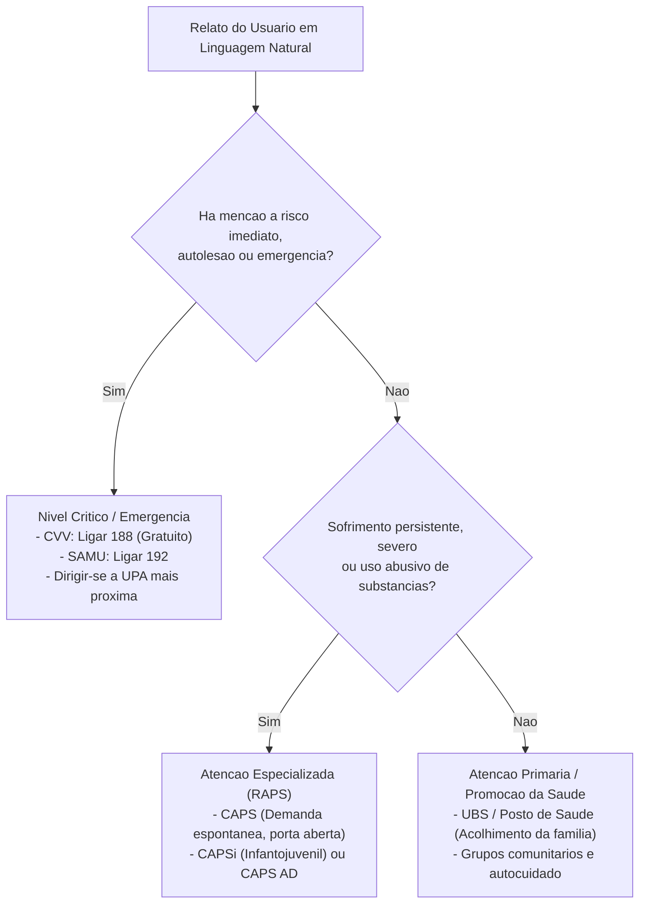

# Guiding Questions e Analise Conceitual

Este documento aprofunda as **Guiding Questions** (questoes norteadoras) do Challenge 2, fundamentando a escolha do tema de qualidade de vida e as decisoes de engenharia, ciencia de dados e MLOps adotadas pelo Grupo 08.

---

## 1. O que e Qualidade de Vida?

O conceito de qualidade de vida varia conforme o campo do conhecimento:
- **Abordagem Socioeconomica:** Medida tradicionalmente pelo Indice de Desenvolvimento Humano (IDH), focando em renda, educacao e longevidade.
- **Abordagem Clinica e de Saude:** Medida por instrumentos padronizados como o **SF-36** (Medical Outcomes Study Short Form Health Survey) e o **WHOQOL-BREF** (Organizacao Mundial da Saude).

### Ponto Focal Escolhido pelo Grupo 08
O grupo optou pelo cruzamento entre **saude mental, relacoes sociais e acesso a servicos publicos**. No WHOQOL, a dimensao psicologica avalia sentimentos positivos, autoestima, memoria e ausencia de sentimentos negativos. Sem estabilidade psiquica e sem saber a quem recorrer em momentos de dor emocional, o individuo perde a capacidade de usufruir de outras esferas de sua vida, gerando impacto negativo em sua renda, educacao e convívio social.

---

## 2. Esferas Analisadas e Justificativa da Escolha

| Esfera de Qualidade de Vida | Problema Observado | Potencial de Impacto da Solucao |
| :--- | :--- | :--- |
| **Educacao** | Dificuldade de acesso a conteudos tecnicos e preparatorios. | Moderado; ja existem multiplas plataformas abertas. |
| **Poder Economico e Financas** | Endividamento, descontrole financeiro e falta de planejamento. | Relevante, mas com alta saturacao de solucoes no mercado financeiro. |
| **Saude Mental e Acesso a Rede (Escolhida)** | **Pessoas em sofrimento psiquico nao sabem onde, como ou quando buscar ajuda; informacao dispersa, burocratica e estigmatizante.** | **Critico e Urgente; lacuna evidente de orientacao humana e acessivel no servico publico.** |
| **Relacoes Sociais e Solidao** | Isolamento social, falta de vinculos afetivos e comunitarios. | Complementar a esfera de saude mental. |
| **Ambiente e Seguranca** | Acesso a saneamento basico, poluicao e seguranca urbana. | Depende fundamentalmente de politicas publicas de infraestrutura fisica. |

---

## 3. Analise Detalhada das Questoes do Desafio

### Saude fisica, mental ou ambas?
A abordagem e integrada, com **foco prioritario em saude mental e acolhimento psicossocial**, mas reconhecendo as interconexoes fisicas:
- Sintomas psicossomaticos (ansiedade gerando taquicardia, insonia, dores musculares) frequentemente levam o paciente a pronto-socorros genericos de forma inadequada.
- O sistema orienta sobre a porta de entrada adequada: se o sintoma tem componente clinico agudo, a indicacao envolve a UBS ou UPA; se o sofrimento e predominantemente psiquico, o CAPS e destacado.

### Qual o tamanho do problema?
- Segundo a OMS, o Brasil e o pais com maior prevalencia de transtornos de ansiedade no mundo (cerca de 9,3% da populacao) e o lider em depressao na America Latina.
- Mais de 70% da populacao depende exclusivamente do SUS para atendimento em saude mental.
- Grande parte dos atendimentos em emergencias psiquiatricas poderia ter sido acolhida na Atencao Basica ou nos CAPS se o paciente soubesse onde buscar ajuda previamente.

### O que LLM + RAG resolve e o que expressamente NAO resolve?
- **O que resolve:** 
  - Traducao de termos e fluxos burocraticos do SUS para linguagem simples, acessivel e empática.
  - Recuperacao contextualizada (RAG) de enderecos, modalidades (CAPS I, II, III, AD, i), horarios e regras de atendimento.
  - Reducao da sobrecarga cognitiva e da angustia inicial da busca por apoio.
- **O que nao resolve:**
  - Nao executa acoes fisicas (nao chama ambulancia automaticamente, nao agenda consultas em sistemas fechados sem integracao oficial).
  - Nao substitui o acolhimento presencial nem o julgamento clinico do profissional de saude.
  - Nao fornece escuta terapeutica continuada (psicoterapia).

### Por que as pessoas nao sabem onde, como ou quando buscar ajuda?
- **Onde:** A rede de atencao psicossocial e diversa e descentralizada (UBS, CAPS I/II/III, CAPS AD, CAPSi, UPA, SAMU, CVV). Cada unidade possui uma missao especifica que raramente e compreendida pelo cidadao comum.
- **Como:** Falta de clareza sobre requisitos: precisa de encaminhamento medico? Pode ir caminhando ate o CAPS? Quais documentos levar? O que falar na recepcao?
- **Quando:** Dificuldade de reconhecer a intensidade do sofrimento, hesitando entre o autocuidado, o atendimento ambulatorial ou o pronto-socorro.
- **Barreiras emocionais:** Estigma social persistente, medo de internacao involuntaria, vergonha perante a familia e receio de ser rotulado.

### Quem e o usuario?
1. O proprio individuo que vivencia angustia, ansiedade, depressao ou sobrecarga psiquica.
2. Amigos, pais ou parceiros que observam o declinio emocional de uma pessoa proxima e nao sabem como ajuda-la institucionalmente.

### Qual e a base de conhecimento do RAG?
- Manuais Oficiais da Rede de Atencao Psicossocial (RAPS) do Ministerio da Saude.
- Cartilhas de Acolhimento e Orientacao do CVV (Centro de Valorizacao da Vida).
- Guias de servicos e enderecos das Secretarias Municipais de Saude.
- Protocolos de Atencao Basica (Cadernos de Atencao Basica no 34 - Saude Mental).

---

## 4. Como o Sistema Decide o Nivel de Cuidado Sem Diagnosticar?

A logica de decisao baseia-se em **niveis de urgencia funcional e escopo de acolhimento**, nunca em nosologias psiquiatricas (como CID ou DSM):

---

## 5. Como Aumentar a Chance de o Usuario Agir?

Estudos de ciencia comportamental indicam que pessoas em estresse severo sofrem paralisia por sobrecarga de informacao. Para maximizar a conversao em acao:
1. **Regra de 3 Passos Concretos:** Nenhuma resposta de orientacao contera mais do que 3 passos praticos imediatos.
2. **Reducao de Friccao:** Informar exatamente o que levar (ex.: Documento com foto e Cartao SUS, se tiver) e como iniciar a conversa ("Ao chegar na recepcao, peca um acolhimento inicial de saude mental").
3. **Validacao Emocional:** Iniciar sempre com tom calmo, acolhedor e seguro, reduzindo a sensacao de culpa ou solidao.

---

## 6. Cuidados Eticos, Legais e de Seguranca

- **Isencao Clinica (Nao-Diagnostico):** Avisos claros de que a plataforma e um facilitador de navegacao no SUS, e nao um profissional de saude.
- **LGPD e Sigilo Absoluto:** Nao solicitar dados como nome civil, CPF, dados bancarios ou detalhes que permitam a reidentificacao do usuario.
- **Rastreabilidade e Prevencao de Danos:** Mecanismos de salvaguarda (guardrails) para garantir que situacoes com indicio de crise recebam contatos telefonicos imediatos de socorro.
