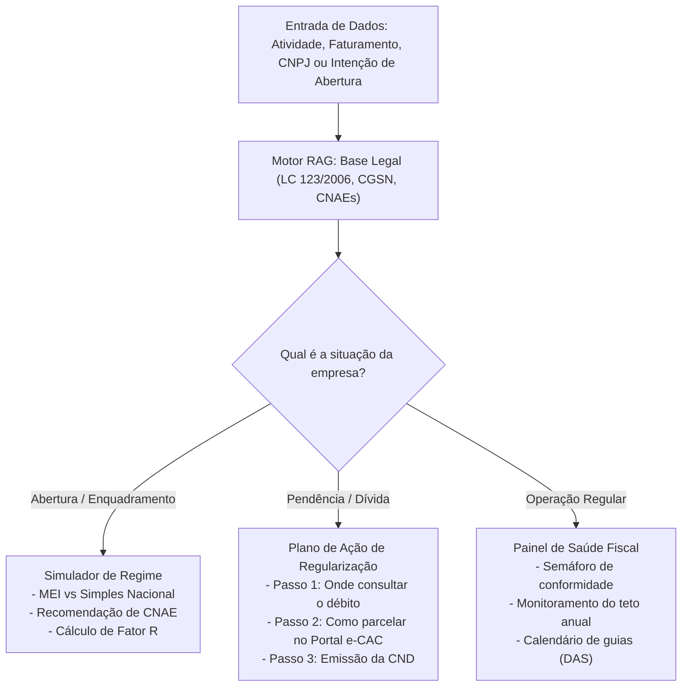

# Guiding Questions e Fundamentação Conceitual

Este documento detalha as **Guiding Questions** (questões norteadoras) do Challenge 2, fundamentando a escolha do tema de gestão fiscal para pequenos negócios e as decisões de engenharia, ciência de dados, arquitetura e MLOps adotadas pelo Grupo 08.

---

## 1. O que é Qualidade de Vida?

O conceito de qualidade de vida varia de acordo com a dimensão analisada:
- **Abordagem Socioeconômica:** Medida pelo Índice de Desenvolvimento Humano (IDH), considerando renda, educação e longevidade.
- **Abordagem Psicológica e de Saúde:** Medida por instrumentos padronizados como o SF-36 e os domínios psicológico e de meio ambiente do WHOQOL (Organização Mundial da Saúde).

### Ponto Focal Escolhido pelo Grupo 08
O grupo optou pelo impacto direto do **estresse financeiro-tributário na qualidade de vida do micro e pequeno empreendedor**. No Brasil, abrir um negócio por necessidade é a realidade de milhões de famílias. Quando o empreendedor vive sob o medo constante da Receita Federal, sem compreender se seus tributos estão corretos e temendo multas que podem levar à insolvência familiar, sua qualidade de vida (sono, saúde emocional e convívio familiar) entra em colapso. 

Capacitar o cidadão a entender e controlar a saúde fiscal de sua empresa é resgatar sua dignidade, segurança patrimonial e estabilidade emocional.

---

## 2. Esferas Analisadas e Justificativa da Escolha

| Esfera de Qualidade de Vida | Problema Observado | Potencial de Impacto da Solução |
| :--- | :--- | :--- |
| **Educação Geral** | Cursos genéricos de capacitação empresarial. | Baixo impacto imediato; taxa de conclusão baixa e pouca aplicabilidade prática. |
| **Poder Econômico / Gestão Fiscal (Escolhida)** | **95% a 99% das empresas são pequenos negócios; contabilidade não é ensinada e o empresário depende cegamente do contador, vivendo sob terror fiscal.** | **Crítico e Transformador: protege a fonte de renda da família, reduz estresse crônico e previne o fechamento do negócio.** |
| **Saúde Estritamente Clínica** | Busca de apoio médico/terapêutico. | Tema amplamente discutido, com alta barreira regulatória médica e necessidade de intervenção presencial. |
| **Ambiente e Segurança** | Infraestrutura urbana e segurança pública. | Depende fundamentalmente de políticas públicas de obras e policiamento. |

---

## 3. Análise Detalhada das Questões do Projeto (Sócio Digital)

### Qual o tamanho do problema no Brasil?
- Mais de 95% das empresas ativas no Brasil são micro e pequenos negócios (MEIs, MEs e EPPs), somando mais de 24 milhões de empresas ativas [1].
- O Brasil ocupa posições críticas globais em tempo gasto para apurar e pagar tributos.
- Mais de 60% dos pequenos negócios encerram suas atividades antes de completar 5 anos de vida, sendo a má gestão tributária e a inadimplência fiscal causas preponderantes.

### Por que o pequeno empreendedor não entende sua contabilidade?
- **Ausência de Ensino:** A educação básica e superior não ensina o funcionamento da tributação nacional (Simples Nacional, DAS, ISS, ICMS, Fator R).
- **Concentração no Contador:** O contador torna-se o único detentor do conhecimento, frequentemente utilizando jargões técnicos que intimidam o cliente.
- **Sobrecarga Operacional:** O microempreendedor atua sozinho ou com equipe reduzida, executando compras, vendas, produção e atendimento, sem tempo hábil para decifrar a legislação.

### O que o LLM + RAG resolve e o que expressamente NÃO resolve?
- **O que resolve:**
  - Traduz jargões técnicos (ex.: "Fator R", "Anexo V", "Substituição Tributária") para explicações simples e simulações reais em Reais (R$).
  - Analisa o enquadramento ideal de CNAE e regime tributário para evitar pagamento indevido de impostos.
  - Gera planos de ação claros em até 3 passos para regularização de dívidas, parcelamentos e emissão de certidões.
  - Alimenta o painel de saúde da empresa com alertas preventivos de vencimentos e limite de faturamento.
- **O que NÃO resolve:**
  - Não assina demonstrativos contábeis oficiais (atribuição privativa de profissionais registrados no CRC).
  - Não executa pagamentos bancários nem transmite declarações fiscais sem consentimento explícito.
  - Não substitui o relacionamento humano e estratégico entre o cliente e seu escritório contábil.

---

## 4. Fluxo de Decisão do Copiloto Sem Exercício Ilegal da Contabilidade

A lógica do Sócio Digital divide-se entre análise consultiva de dados e roteamento de regularização:

---

## 5. Como Medir o Impacto na Qualidade de Vida?

1. **Índice de Redução de Incerteza (Pesquisa Perceptiva):** Proporção de usuários que declaram ter compreendido com clareza o que estão pagando e qual o próximo passo a seguir.
2. **Economia Financeira Identificada:** Montante em Reais (R$) de redução de custo tributário legal gerado pela adoção de enquadramentos adequados.
3. **Redução de Ocorrência de Multas por Atraso:** Proporção de usuários que mantêm as guias em dia por meio dos lembretes e tarefas estruturadas no painel.
