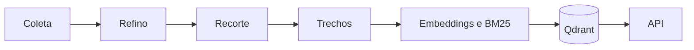
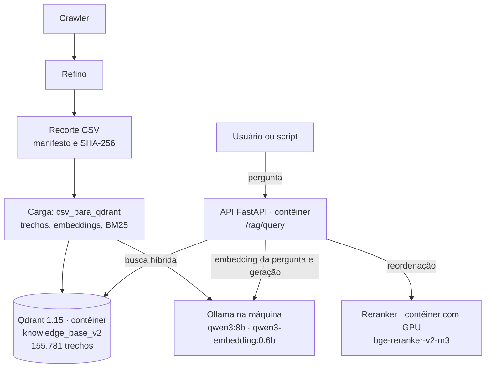

# Pipeline de Ingestão de Dados Fiscais — Sócio Digital

> **Frente:** Ciência de Dados & Engenharia de Dados
> **Responsáveis:** Jhessica & Lucas
> **Projeto:** Sócio Digital — RES-IA Challenge 2
> **Versão:** 3.0 (base `knowledge_base_v2`, 07/11/2026)
> **Status:** Implementado; a base da demonstração foi carregada por este caminho

---

## 1. Visão Geral

O pipeline transforma o acervo coletado de fontes oficiais em trechos indexados no Qdrant, prontos para a rota `/rag/query` da API.



## 2. Sistema Implementado

O diagrama mostra só o que roda hoje. A arquitetura-alvo, com frontend, banco da empresa e integrações fiscais, está em `docs/arquitetura.md`.



A coluna da esquerda roda uma vez por versão da base; a da direita, a cada pergunta.

| Componente | Onde roda | Papel |
|---|---|---|
| API FastAPI (`backend/api`) | Contêiner | Busca, monta o contexto, chama o gerador e devolve resposta com fontes |
| Qdrant 1.15 | Contêiner, volume próprio | Guarda vetor denso, vetor esparso e metadados de cada trecho |
| Reranker (`backend/reranker`) | Contêiner com GPU | Reordena os candidatos; se falhar, a busca segue sem ele |
| Ollama | Máquina, fora do Docker | Gera embeddings e respostas |
| `src/rag/csv_para_qdrant.py` | Linha de comando | Carga do recorte na coleção |

Máquina usada: RTX 3080 Ti de 12 GB e 32 GB de RAM.

---

## 3. Etapas

### Etapa 1: Coleta (`backend/crawler/`)
- Coleta de portais oficiais: Receita Federal, Câmara dos Deputados, Receita do DF, SINJ-DF, CONFAZ, SPED, CARF e STJ.
- Guarda o documento original, a URL de origem e a data de coleta (`coletado_em`).

### Etapa 2: Refino (`backend/refino/`)
- Limpeza não destrutiva, normalização Unicode e resolução de identidade: conteúdos idênticos compartilham o mesmo hash SHA-256.
- Classificação por natureza (legislação, consulta tributária, manual etc.) e escolha da versão preferida de cada documento.

### Etapa 3: Recorte (`src/rag/recorte_csv.py`)
- Exporta a versão preferida de cada documento do índice do refino para um CSV, com o texto sem alteração.
- Com `--publico`, aplica regras de exclusão a documentos inteiros (por exemplo, dados pessoais ou identificação de partes) e grava um manifesto com contagens, SHA-256 e a lista dos excluídos.
- Resultado: `data/recorte-rag-v1/recorte-publico.csv.gz`, com 4.026 documentos. Quatro documentos barrados pelo filtro foram liberados após conferência manual e sete documentos oficiais ficaram num complemento; os dois arquivos estão fora do repositório. Detalhes em `docs/lista-documentos-fonte.md`.
- A vigência não é verificada: `vigencia_fonte` fica vazio.

### Etapa 4: Trechos (`src/rag/chunker.py`)
- Um trecho por artigo, com até 2.000 caracteres de corpo e 200 de sobreposição; documentos sem artigo são divididos por seção Markdown.
- Cabeçalho de contexto com documento, fonte, capítulo e artigo no início de cada trecho.
- Remove segmentos repetidos e texto riscado; o original com rasuras fica em `texto_com_rasuras`. As páginas de login do CARF são descartadas.
- Detalhes em `docs/estrategia-chunking.md`.

### Etapa 5: Embeddings e BM25
- Vetor denso de 1024 dimensões com `qwen3-embedding:0.6b`, gerado pelo Ollama na placa de vídeo, em lotes de 64.
- Vetor esparso BM25, calculado em Python (`backend/api/app/sparse.py`).
- Detalhes em `docs/estrategia-embeddings.md`.

### Etapa 6: Carga no Qdrant (`src/rag/csv_para_qdrant.py`)
- Coleção `knowledge_base_v2`, com vetores `dense` (cosseno) e `sparse` (IDF), e índices nos campos `document_id`, `norma`, `artigo`, `frente` e `ordem`.
- Antes de gravar um documento, apaga os pontos antigos dele; repetir a carga não duplica.
- A coleção anterior, `knowledge_base`, segue intacta para comparação.

---

## 4. Comandos

### 4.1 Conferir o recorte

```bash
sha256sum data/recorte-rag-v1/recorte-publico.csv.gz
# 0815a880c65f3c2044f8f0bda1fb5a9fb7a0e21f2c13e46ca0652ad58ebf0511
```

### 4.2 Subir Qdrant, reranker e API

```bash
docker compose -f backend/compose.yaml up -d
```

O Ollama precisa estar rodando na máquina com `qwen3:8b` e `qwen3-embedding:0.6b`. Sem os modelos, `/ready` responde 503.

### 4.3 Simular e gravar a carga

```bash
# conta trechos e pontos, sem modelo nem Qdrant
python -m src.rag.csv_para_qdrant --csv data/recorte-rag-v1/recorte-publico.csv.gz --dry-run

# grava; --colecao é obrigatório
python -m src.rag.csv_para_qdrant --csv data/recorte-rag-v1/recorte-publico.csv.gz --colecao knowledge_base_v2
```

Os arquivos liberados após revisão e o complemento oficial são carregados com o mesmo comando, na mesma coleção.

### 4.4 Consultar

```bash
curl -s http://localhost:8000/rag/query \
  -H "Content-Type: application/json" \
  -d '{"question": "Qual é o limite de faturamento anual do MEI?"}'
```

A resposta traz `status`, `answer` e `sources`, com `text`, `source`, `score`, `title`, `document_id` e `chunk_id` de cada trecho.

### 4.5 Avaliar

```bash
cd backend/api
python -m evaluation run --dataset ../evaluation/data/teste_final_v2_2026-11-07.jsonl --run-dir ../evaluation/runs/<nome> --all
```

Usa o mesmo serviço de busca e geração da API, com Qdrant e Ollama no ar. Instalação e imagem Docker em `backend/evaluation/README.md`. As métricas e os conjuntos de perguntas estão em `docs/metricas-avaliacao-rag.md`.
