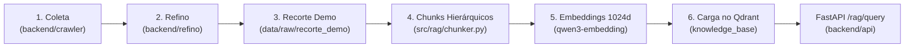

# Pipeline de Ingestão de Dados Fiscais — Sócio Digital

> **Frente:** Ciência de Dados & Engenharia de Dados  
> **Responsáveis:** Jhessica & Lucas  
> **Projeto:** Sócio Digital — RES-IA Challenge 2  
> **Versão:** 2.0 (Alinhada ao Plano de Entrega de 09/11/2026)  
> **Status:** Homologado

---

## 1. Visão Geral da Arquitetura do Pipeline

O pipeline de ingestão do **Sócio Digital** transforma o acervo bruto coletado de fontes governamentais e normativas em pontos vetoriais altamente estruturados, indexados e prontos para consulta na API FastAPI e no Qdrant.

O fluxo de dados é estruturado em 6 macroetapas:

$$\mathbf{Coleta} \longrightarrow \mathbf{Refino} \longrightarrow \mathbf{Recorte} \longrightarrow \mathbf{Chunks} \longrightarrow \mathbf{Embeddings} \longrightarrow \mathbf{Qdrant}$$



---

## 2. Detalhamento de Cada Etapa

### Etapa 1: Coleta Primária (`backend/crawler/`)
- **Responsabilidade:** Rastreamento automatizado de portais oficiais (Receita Federal, Câmara dos Deputados, SEFAZ-DF, CONFAZ, SPED, CARF e STJ).
- **Características:** Preservação estrita dos documentos originais, snapshots HTML/PDF e registro de URL canônica e carimbo de data/hora (`coletado_em`).
- **Artefatos:** Armazenamento local particionado em `backend/crawler/data/`.

### Etapa 2: Refino e Resolução de Identidade (`backend/refino/`)
- **Responsabilidade:** Limpeza não destrutiva, normalização Unicode NFC e resolução de identidade lógica.
- **Deduplicação Inteligente:** Atos normativos e soluções de consulta com conteúdos idênticos compartilham um mesmo hash SHA-256 de conteúdo, preservando suas diferentes ocorrências institucionais.
- **Classificação por Política:** O arquivo `politica.json` classifica cada documento em `nucleo`, `complementar`, `historico`, `dados_estruturados` ou `revisao`.
- **Artefatos:** JSONLs de governança (`documentos.jsonl`, `versoes.jsonl`, `conteudos.jsonl`, `indice_nucleo.jsonl`).

### Etapa 3: Recorte Curado da Demonstração (`data/raw/recorte_demo/`)
- **Responsabilidade:** Seleção das 9 frentes centrais prioritárias do desafio, totalizando **46 documentos canônicos**:
  1. *Legislação:* LC 123/2006, CGSN 140/2018, CTN, LC 116/2003, LGPD, EC 132/2023, LC 214/2025.
  2. *Legislação Complementar:* LC 128, LC 147, LC 155, LC 188, LC 87, Dec 6.022, Lei 12.741, Ajustes SINIEF 07 e 19.
  3. *Manuais Fiscais:* PGDAS-D/DEFIS, PGMEI, DASN-SIMEI, FAQs Oficiais Simples e MEI.
  4. *Frente MEI:* Regras de formalização, impedimentos, ocupações permitidas e encerramento.
  5. *SPED:* Manuais técnicos de ECD, ECF, EFD-Contribuições e EFD-ICMS/IPI.
  6. *ISS e Tributos DF:* Decretos Distritais nº 25.508/2005 e nº 43.982/2022, NFS-e DF, guias de retenção e Web Service.
  7. *Lucro Presumido:* Leis federais nº 9.249 e 9.430, RIR/2018 e IN RFB 1.700.
  8. *Calendário DF:* Portaria RFB nº 11.460, Lei DF nº 963 e Decreto DF nº 48.117.
  9. *Jurisprudência:* Acórdãos selecionados de pejotização (CARF) e prescrição de declarações (STJ).
- **Contrato de Metadados:** Frontmatter padronizado com `document_id`, `title`, `jurisdicao`, `natureza_documental` e `coletado_em`.

### Etapa 4: Segmentação Hierárquica Jurídica (`src/rag/chunker.py`)
- **Responsabilidade:** Segmentar cada documento respeitando dispositivos normativos e seções estruturadas.
- **Regras:**
  - Janela máxima de **2.000 caracteres**.
  - Sobreposição (**overlap**) de **200 caracteres**.
  - **Injeção de Contexto:** Cabeçalho com Fonte, Document ID, Artigo, Parágrafo e Caput Anchor.
  - **Classificação de Tags Fiscais:** Detecção automática de regimes e tópicos para roteamento.

### Etapa 5: Geração de Embeddings (`qwen3-embedding:0.6b`)
- **Responsabilidade:** Converter o texto do chunk em vetor de densidade semântica.
- **Configuração:** 1024 dimensões, normalização vetorial L2 e distância de Cosseno.
- **Ambiente:** Ollama na máquina com GPU RTX 3080 Ti de 32 GB.

### Etapa 6: Carga e Indexação no Qdrant (`scripts/ingest_qdrant.py`)
- **Responsabilidade:** Persistir e indexar os pontos vetoriais com payload no Qdrant.
- **Coleção:** `knowledge_base`.
- **Payload Schema:** Estritamente compatível com o modelo Pydantic `backend/api/app/schemas.py:Source`.

---

## 3. Comandos de Reprodução do Pipeline

### 3.1 Gerar Recorte Curado das 46 Fontes Centrais:
```bash
python scripts/build_recorte_demo.py
```

### 3.2 Executar Chunking Hierárquico e Exportar Pontos Qdrant:
```bash
python -c "from src.rag.ingest import IngestionPipeline; IngestionPipeline(raw_dir='data/raw/recorte_demo', manifest_path='data/processed/manifest_recorte_46.json').run()"
```
- Gera `data/processed/qdrant_points.jsonl` (132 pontos formatados).
- Gera `data/processed/vector_index.db` (banco de apoio local).
- Gera `data/processed/manifest_recorte_46.json` (auditoria MLOps).

### 3.3 Carregar os Pontos no Qdrant (Máquina GPU):
```bash
python scripts/ingest_qdrant.py --qdrant-url http://localhost:6333 --ollama-url http://localhost:11434
```
Ou em modo de validação dry-run:
```bash
python scripts/ingest_qdrant.py --dry-run
```

### 3.4 Validar a Recuperação de Ponta a Ponta:
```bash
python scripts/avaliar_recuperacao_qdrant.py
```
- Executa as 20 rodadas de calibração de `top_k` e `score_threshold` contra o benchmark de 25 perguntas fiscais.

