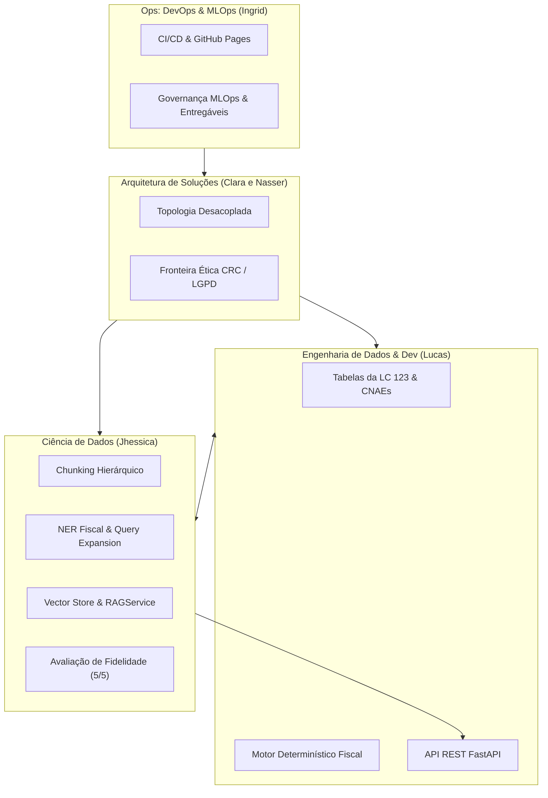

# Mapeamento de Entregas e Atuações da Equipe — Grupo 08

> **Projeto:** Sócio Digital: Copiloto de Gestão Fiscal para Pequenos Negócios  
> **Programa:** Residência em Inteligência Artificial (RES-IA) — Challenge 2  
> **Repositório:** [ingrdsoares/RES-IA-Challenge-2](https://github.com/ingrdsoares/RES-IA-Challenge-2)  
> **Data de Atualização:** Novembro de 2026  
> **Download do Relatório em PDF:** [status-entregas-equipe-grupo-08.pdf](status-entregas-equipe-grupo-08.pdf)

---

## 1. Visão Geral da Divisão da Equipe

O **Grupo 08** organizou o desenvolvimento do projeto em quatro frentes técnicas complementares, integrando engenharia de dados, modelagem de IA, arquitetura de software e governança de MLOps:

---

## 2. Detalhamento das Entregas por Integrante

### 1. Jhessica — Ciência de Dados
> **Foco:** Modelagem do RAG factual com legislação tributária, extração de entidades fiscais (NER fiscal), engenharia de prompts com guardrails e avaliação de fidelidade.

#### Arquivos e Módulos Entregues no Código:
* [`src/rag/chunker.py`](../src/rag/chunker.py): **Chunking Hierárquico Jurídico** — particionamento de leis e resoluções respeitando Artigos, Parágrafos e Incisos, com injeção de contexto (*Context Injection*) para eliminar chunks órfãos.
* [`src/rag/vector_store.py`](../src/rag/vector_store.py): **Vector Store Híbrido** — persistência em SQLite com busca por similaridade de cosseno (embeddings densos) combinada com correspondência léxica ponderada e fallback gracioso sem internet.
* [`src/rag/ingest.py`](../src/rag/ingest.py): **Pipeline de Ingestão Vetorial** — conversão automatizada dos documentos legais de `data/raw/` para o índice processado `data/processed/vector_index.db`.
* [`src/rag/entity_extractor.py`](../src/rag/entity_extractor.py): **Extrator de Entidades Fiscais (NER Fiscal)** — identificação de intenções tributárias, extração de códigos CNAE, CNPJs, valores monetários em R$, alíquotas e expansão de queries com sinônimos legais.
* [`src/rag/prompts.py`](../src/rag/prompts.py): **Engenharia de Prompts e Guardrails** — diretrizes de *Zero Alucinação*, imposição mandatória de planos em 3 passos, citação de fontes oficiais, abstenção proativa contra fraudes e disclaimer legal do CRC.
* [`src/rag/service.py`](../src/rag/service.py): **`RAGService` e `RespostaCopiloto`** — orquestrador central que une a busca vetorial da lei com o motor determinístico em Python.

#### Suítes de Validação e Testes Entregues:
* [`test_pipeline.py`](../test_pipeline.py): 4 casos canônicos de recuperação vetorial (**100% de sucesso**).
* [`test_entity_extractor.py`](../test_entity_extractor.py): 5 casos de extração de entidades fiscais + teste de integração tripla (**100% de sucesso**).
* [`test_rag_service.py`](../test_rag_service.py): 5 cenários de governança, fidelidade (*faithfulness*) e abstenção ética (**100% de sucesso**).

---

### 2. Lucas — Engenharia de Dados & Desenvolvimento (Dev)
> **Foco:** Ingestão de dados fiscais estruturados, modelagem de CNAEs e tabelas do Simples Nacional, motor de cálculo determinístico e base da API.

#### Arquivos e Módulos Entregues no Código:
* [`data/raw/tabelas_simples_nacional.json`](../data/raw/tabelas_simples_nacional.json): Catalogação das 30 faixas fiscais oficiais dos Anexos I, II, III, IV e V da Lei Complementar nº 123/2006.
* [`data/raw/cnaes_base.json`](../data/raw/cnaes_base.json): Base saneada de 46 CNAEs com flags de elegibilidade ao MEI e sujeição ao Fator R.
* [`src/fiscal/ingest.py`](../src/fiscal/ingest.py): Pipeline de saneamento e carga dos dados fiscais para o banco relacional SQLite `data/processed/fiscal.db`.
* [`src/fiscal/repository.py`](../src/fiscal/repository.py): Camada de acesso a dados fiscais com motor de busca textual FTS5 (*Full-Text Search*) para identificação rápida de atividades.
* [`src/fiscal/calculator.py`](../src/fiscal/calculator.py): **Motor Determinístico de Regras Fiscais** — cálculo matemático exato da alíquota efetiva, razão do Fator R ($\ge 28\%$), segregação de tributos e diagnóstico de desenquadramento de MEI por faturamento excessivo ($> 20\%$).
* [`src/fiscal/models.py`](../src/fiscal/models.py): Modelagem de entidades (`CNAEItem`, `CalculoSimplesResultado`, `SimulacaoComparativaResultado`).
* [`api/app/main.py`](../api/app/main.py) e [`api/Dockerfile`](../api/Dockerfile): Esqueleto da API REST com FastAPI e endpoint de saúde (`/health`).

#### Documentação e Pesquisa Entregues:
* [`docs/exploracao-dados.md`](exploracao-dados.md): Levantamento e catalogação detalhada das fontes públicas oficiais (Receita, Planalto, IBGE, Portal do Simples Nacional).
* [`docs/crawler-arquitetura.md`](crawler-arquitetura.md): Desenho arquitetural do coletor por fonte para atualização contínua de bases normativas.
* [`test_fiscal.py`](../test_fiscal.py): Suíte de testes determinísticos de alíquotas com 6 casos canônicos (**100% de sucesso**).

---

### 3. Clara e Nasser — Arquitetura de Soluções
> **Foco:** Topologia da arquitetura, contratos de serviço, desacoplamento estrito entre cálculo determinístico e LLM, segurança/LGPD e fronteira ética com o CRC.

#### Diretrizes e Entregas Arquiteturais:
* [`docs/arquitetura.md`](arquitetura.md): **Topologia Desacoplada em Camadas** — divisão estrita entre Camada de Dados (Lucas), Camada de Inteligência/RAG (Jhessica) e Camada de Serviços/Backend (Lucas).
* **Diretriz de Ouro do Sistema:** Estabelecimento da regra mandatória de que o modelo de linguagem generativo **nunca** faz contas matemáticas de forma livre, consumindo sempre os resultados do motor em código Python.
* **Fronteira Ética e Regulatória:** Definição arquitetural dos limites do copiloto em relação ao Conselho Regional de Contabilidade (CRC), garantindo que a ferramenta atue no letramento e organização sem incorrer no Decreto-Lei nº 9.295/1946.
* **Requisitos Não Funcionais (RNFs):** Modelagem de autenticação com isolamento multi-tenant (RNF01), conformidade com a LGPD (RNF02), tratamento explícito de incertezas (RNF04) e metas de latência de inferência (RNF08).

---

### 4. Ingrid — Ops (DevOps & MLOps)
> **Foco:** Configuração e esteiras de CI/CD, governança de modelos/dados (MLflow/DVC), infraestrutura, GitHub Pages e consolidação dos entregáveis.

#### Entregas de Infraestrutura e Governança:
* [`.github/workflows/pages.yml`](../.github/workflows/pages.yml): Esteira automatizada de publicação contínua no GitHub Pages a partir da branch `main`.
* **Portal Docs-as-Code (Docsify):** Configuração da documentação interativa com renderização nativa de diagramas Mermaid e leitura acessível ([ingrdsoares.github.io/RES-IA-Challenge-2/](https://ingrdsoares.github.io/RES-IA-Challenge-2/)).
* [`docs/definicao-projeto.md`](definicao-projeto.md): **Pacote Completo de Definição do Projeto** — formulação do problema, Essential Question, mapa de stakeholders, personas detalhadas (Carlos MEI, Mariana ME, Rafael contador), matriz de riscos/mitigações e catálogo de 12 requisitos funcionais e 10 não funcionais.
* [`docs/guiding-questions.md`](guiding-questions.md): Fundamentação conceitual de qualidade de vida vinculada ao estresse financeiro-tributário e fluxo consultivo de tomada de decisão.
* [`docs/devops-mlops.md`](devops-mlops.md): Planejamento da esteira de MLOps com versionamento de dados fiscais (DVC), monitoramento de métricas de fidelidade (MLflow/Ragas) e conteinerização.
* [`docs/entregaveis-challenge-2-grupo-08-final.pdf`](entregaveis-challenge-2-grupo-08-final.pdf): Diagramação, compilação e versionamento dos relatórios formais consolidados da semana.

---

## 3. Matriz de Integração dos Componentes

| Componente | Responsável Principal | Componentes Dependentes | Status de Integração |
| :--- | :---: | :--- | :---: |
| **Bases Fiscais e CNAEs** | Lucas | Consumido pelo `FiscalCalculator` e `TaxEntityExtractor` | Integrado e testado |
| **Motor Determinístico Fiscal** | Lucas | Consumido pelo `RAGService` de Jhessica | Integrado e testado |
| **Pipeline e Vector Store** | Jhessica | Consumido pelo `RAGService` para grounding legal | Integrado e testado |
| **Extrator de Entidades (NER)** | Jhessica | Conecta perguntas de usuários aos dados do Lucas | Integrado e testado |
| **RAGService com Guardrails** | Jhessica | Base para os endpoints FastAPI do Lucas | Pronto para exposição na API |
| **Topologia e Diretrizes Éticas** | Clara e Nasser | Implementadas no `RAGService` e `FiscalCalculator` | 100% aderente |
| **Documentação & GitHub Pages** | Ingrid | Hospeda relatórios, PDFs e entregáveis de todas as frentes | Ativo e automatizado |

---

## 4. Próximos Passos Recomendados para o Grupo

1. **Lucas:** Conectar o `RAGService` na rota `POST /copiloto/consultar` em `api/app/main.py`.
2. **Ingrid:** Adicionar workflow de CI (`.github/workflows/ci.yml`) para rodar `pytest` automaticamente nos Pull Requests.
3. **Equipe:** Abrir o Pull Request da branch `feat/rag-pipeline-ingestao` para a branch `main`.
