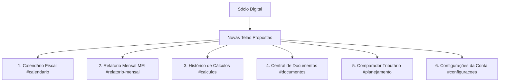

# Sugestões de Melhorias e Novas Telas para o Frontend

Este documento consolida uma análise detalhada da estrutura atual do frontend do **Sócio Digital**, propondo melhorias para as telas existentes, especificações de novas telas de alto valor para o negócio e recomendações técnicas de arquitetura e UX.

---

## 1. Contexto da Estrutura Atual do Frontend

* **Tecnologias:** React 18, TypeScript, Tailwind CSS, Design Tokens personalizados (`tokens.css`, `index.css`), Lucide Icons.
* **Roteamento:** Hash routing (`#assistente`, `#dashboard`, `#fiscal`, `#tarefas`, `#normas`, `#leitor`, `#perfil`, `#cadastro`).
* **Público-alvo:** Microempreendedores Individuais (MEIs), Microempresas (MEs), pequenos negócios optantes pelo Simples Nacional e apoio a escritórios contábeis.
* **Integração com Backend:** FastAPI com autenticação por sessão, RAG híbrido com embeddings locais/Ollama ou provedores em nuvem, cálculo do Simples Nacional/MEI, repositório de certidões/obrigações e gestão de tarefas.

---

## 2. Melhorias nas Telas Já Existentes

### 2.1. Assistente Fiscal (`frontend/src/pages/Assistente.tsx`)

* [ ] **Feedback Explícito de Qualidade de Resposta:** _Parcial: há botões e motivos prontos; falta o comentário livre._
  * Integrar botões de avaliação (*Útil* / *Não útil* com campo de comentário rápido opcional) consumindo a rota existente `POST /rag/feedback`.
* [x] **Transformação de Resposta em Tarefa com 1 Clique:**
  * Adicionar botão de ação direta nos itens de `next_steps` e orientações práticas para disparar a criação de tarefas sem necessidade de redigitação pelo usuário.
* [ ] **Histórico Lateral de Conversas:** _Parcial: lista e busca prontas; faltam renomear e arquivar._
  * Implementar gaveta/painel lateral retrátil listando as conversas anteriores da empresa (`GET /empresas/{company_id}/conversas`), com busca textual, opção de renomear e arquivar.
* [x] **Atalhos Rápidos de Perguntas Frequentes (Pills):**
  * Cards clicáveis antes da primeira mensagem (*"Como emitir meu DAS este mês?"*, *"Qual o limite de faturamento anual?"*, *"O que é o Fator R no meu CNAE?"*).
* [x] **Exportação de Conversa:**
  * Botão para exportar o diálogo em formato PDF ou Markdown estruturado, ideal para compartilhar com o contador da empresa.

---

### 2.2. Visão Geral / Dashboard (`frontend/src/pages/Dashboard.tsx`)

* [x] **Termômetro de Limite de Faturamento Anual:**
  * Barra de progresso visual para acompanhamento da receita bruta acumulada em relação ao teto do MEI (R$ 81.000,00) ou faixas do Simples Nacional, alertando sobre risco de desenquadramento.
* [x] **Card de Alerta de Urgência (D-Day):**
  * Banner no topo destacando obrigações fiscais ou certidões que vencem nos próximos 5 a 7 dias, com contagem regressiva e atalho para regularização.
* [ ] **Desacoplamento do Simulador Tributário:** _Pendente: o formulário completo continua no dashboard._
  * Reduzir o formulário de simulação no dashboard a um widget compacto de chamada e criar uma visão completa dedicada à simulação e planejamento.

---

### 2.3. Situação Fiscal & Evidências (`frontend/src/pages/Fiscal.tsx` e `RecordDetail.tsx`)

* [ ] **Área de Drag-and-Drop e Pré-visualização de Arquivos:** _Parcial: dropzone e preview de imagem prontos; falta o preview de PDF._
  * Substituir o campo de arquivo padrão por uma dropzone intuitiva com preview de PDF e imagens antes do envio para `/evidencias/{evidence_id}/arquivo`.
* [ ] **Semáforo de Validade de Certidões Negativas (CNDs):** _Parcial: status e atalho da CND federal prontos; falta o atalho da Caixa/FGTS._
  * Adicionar indicador de status temporal (Válida, Vence em menos de 30 dias, Expirada), com botão de atalho para os órgãos emissores (Receita Federal, Caixa/FGTS, PGFN).
* [x] **Filtros por Exercício e Agrupamento:**
  * Permitir filtrar histórico de evidências por ano-calendário e por competência específica.

---

### 2.4. Tarefas da Empresa (`frontend/src/pages/Tarefas.tsx`)

* [x] **Alternância de Visualização (Lista vs. Calendário):**
  * Permitir alternar entre a exibição tabular/lista atual e uma visualização em grade de calendário mensal.
* [x] **Geração Automática de Obrigações do Ano:**
  * Botão *"Gerar obrigações do ano"* que cria em lote as obrigações ainda não vencidas: DAS mensal (dia 20), declaração anual (DASN-SIMEI ou DEFIS) e renovações de certidões, sem repetir tarefas existentes.
* [ ] **Tags e Categorias de Tarefas:** _Parcial: falta a categoria Cadastral._
  * Distinção visual entre tarefas de natureza `Tributária`, `Trabalhista/Previdenciária`, `Cadastral` e `Certidões`.

---

### 2.5. Perfil e Cadastro da Empresa (`frontend/src/pages/Empresas.tsx`)

* [ ] **Autopreenchimento Inteligente por CNPJ:** _Pendente._
  * Integração com serviço de consulta pública de CNPJ (ex: BrasilAPI / ReceitaWS) para autopreencher Razão Social, Nome Fantasia, CNAEs e endereço ao digitar os 14 dígitos.
* [ ] **Suporte a Múltiplos CNAEs Secundários:** _Pendente._
  * Permitir cadastrar e visualizar a lista completa de atividades secundárias permitidas, fundamentais para a análise tributária correta.

---

### 2.6. Landing Page (`frontend/src/pages/Landing.tsx`)

* [x] **Mini Simulador Público Interativo:**
  * Componente interativo público para estimar o valor do imposto aproximado sem necessidade imediata de login, servindo como canal de conversão.
* [x] **Selos de Segurança e Fontes Confiáveis:**
  * Seção reforçando o respaldo em fontes normativas oficiais (Receita Federal, CGSN, Diário Oficial da União) e conformidade com a LGPD.

---

## 3. Sugestão de Novas Telas

### 3.1. Calendário Fiscal Unificado (`#calendario`)
* **Objetivo:** Oferecer uma visão cronológica unificada de todas as datas críticas do ano da empresa.
* **Funcionalidades:**
  * Grade mensal com destaques para: vencimento do DAS, entrega de declarações anuais (DASN-SIMEI, DEFIS), vencimento de alvarás e CNDs.
  * Filtro por status (Pago, Pendente, Atrasado).
  * Botão de exportação para **Google Agenda / Apple Calendar (.ics)**.
* **Viabilidade Técnica:** Alta — consome dados já existentes em `/empresas/{id}/tarefas` e `/empresas/{id}/obrigacoes`.

---

### 3.2. Relatório Mensal das Receitas Brutas (`#relatorio-mensal`)
* **Objetivo:** Cumprimento da exigência legal para MEIs (Resolução CGSN nº 140/2018), que exige o preenchimento mensal desse relatório até o dia 20.
* **Funcionalidades:**
  * Campos para informar receitas com e sem nota fiscal de:
    1. Revenda de mercadorias (comércio).
    2. Venda de produtos industrializados (indústria).
    3. Prestação de serviços.
  * Somatório automático e verificação de limite proporcional acumulado no ano.
  * Geração e download do **PDF oficial formatado**, pronto para assinatura e arquivo fiscal com os comprovantes anexos.
* **Viabilidade Técnica:** Alta — pode funcionar com formulário interativo no frontend e renderização em PDF.

---

### 3.3. Histórico e Auditoria de Cálculos Fiscais (`#calculos`)
* **Objetivo:** Dar visibilidade a todas as simulações e memórias de cálculo geradas pela plataforma.
* **Funcionalidades:**
  * Tabela com histórico de cálculos obtidos via `GET /empresas/{company_id}/calculos`.
  * Detalhes de cada cálculo: Alíquota Efetiva apurada, Fator R aplicado, Anexo enquadrado, memória de cálculo passo a passo e normas jurídicas referenciadas.
  * Gráfico comparativo de evolução da carga tributária mês a mês.
* **Viabilidade Técnica:** Imediata — o backend já possui as rotas `/empresas/{company_id}/calculos` e `/calculos/{calculation_id}` totalmente implementadas.

---

### 3.4. Central de Documentos & Cofre Digital (`#documentos`)
* **Objetivo:** Centralizar todos os PDFs de guias, comprovantes e certidões anexadas à empresa.
* **Funcionalidades:**
  * Tabela com busca rápida, filtros por tipo (Guia DAS, Comprovante Bancário, Certidão Negativa, Contrato/CCMEI).
  * Download em lote (`.zip`) de todos os documentos de determinada competência para envio direto ao contador no fechamento do mês.
* **Viabilidade Técnica:** Média — reaproveita `/empresas/{id}/evidencias` com agregador de download.

---

### 3.5. Comparador e Planejamento Tributário (`#planejamento`)
* **Objetivo:** Auxiliar empresas em fase de crescimento a planejar a transição de MEI para ME (Microempresa no Simples Nacional) ou avaliar o impacto do Fator R (Anexo III vs. Anexo V).
* **Funcionalidades:**
  * Simulação comparativa em tela dividida: *Cenário Atual (MEI)* vs. *Cenário Projetado (Simples Nacional)*.
  * Estimativa de custos adicionais com contabilidade, folha de pagamento mínima para enquadramento no Anexo III e impostos incidentes.
* **Viabilidade Técnica:** Média — utiliza o motor de cálculo tributário já existente no backend com variações de parâmetros.

---

### 3.6. Central de Notificações & Configurações da Conta (`#configuracoes`)
* **Objetivo:** Gerenciar credenciais, preferências de avisos e acessos da empresa.
* **Funcionalidades:**
  * Alteração de e-mail e redefinição de senha com base em `/auth/password-reset`.
  * Configuração de alertas de vencimento (notificações push no navegador ou e-mail).
  * Modo de acesso compartilhado para o contador da empresa (leitura de relatórios).
* **Viabilidade Técnica:** Alta — consome rotas de autenticação existentes.

---

## 4. Melhorias Técnicas de Frontend & UX

1. **Sistema Global de Toasts / Notificações Flutuantes:**
   * Substituir mensagens de status locais por um contexto global de notificações flutuantes (sucesso, erro, alerta).
2. **Skeleton Screens nos Carregamentos:**
   * Substituir mensagens textuais de "Carregando..." por esqueletos animados (`animate-pulse`), melhorando a percepção de performance.
3. **Persistência de Parâmetros e Filtros na URL:**
   * Permitir que filtros de tarefas e telas fiscais sejam refletidos nos parâmetros da rota (ex: `#tarefas?status=pending&period=2026-11`), viabilizando recarregamento de página sem perda de estado.
4. **Tratamento de Estados Vazios (Empty States):**
   * Ilustrações e mensagens encorajadoras com botões de ação primária quando listas de tarefas, evidências ou conversas estiverem vazias.
