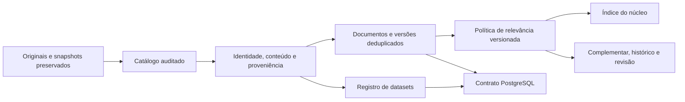

# Refino do acervo tributário — desenho inicial

## Objetivo e decisões

Organizar o acervo existente, reduzir repetição na consulta e expor somente conteúdo pertinente ao perfil selecionado, mantendo evidência e possibilidade de revisão. O usuário confirmou todos os regimes tributários, com foco no DF. Esse é o perfil padrão tributario_df; MEI/Simples DF e nacional amplo ficam como perfis alternativos configuráveis. PostgreSQL permanece o destino do modelo relacional. Nesta primeira execução o pipeline gera arquivos JSONL/Markdown e DDL, sem presumir servidor, credenciais ou migração já existente.

Originais e coletas anteriores permanecem imutáveis. Remover repetição significa compartilhar conteúdo e consolidar identidades na camada refinada; não apagar arquivos brutos ou eliminar versões jurídicas. Não há inferência automática de vigência, aplicabilidade ou força vinculante.

## Diagnóstico real de entrada

7.213 snapshots. Ato RFB ou URL primária exata: 858 grupos repetidos, 922 ocorrências adicionais. Há 119 grupos de Markdown idêntico em bytes (133 adicionais); a remoção somente do frontmatter aumenta a equivalência textual, mas não autoriza fundir versões. Em 701 grupos com mesma identidade/hash primário existem Markdown diferentes. A SC Cosit 140/2025 (ato 145726) tem extração de 33.893 caracteres e outra de 68.062, com visão adicional. Portanto, hash primário não identifica a totalidade de um snapshot.

O catálogo também inclui dados estruturados, índices e evidências. CNPJ não pode ser convertido em uma sequência de documentos RAG por empresa; o recorte completo DF contém registros e partições que devem ser representados como dataset, com referência ao manifesto completo. Seis entradas têm frontmatter no próprio Markdown e sete não têm Markdown textual. Esses formatos precisam ser tratados explicitamente.

## Camadas

## Modelo

- Documento: identidade lógica, por autoridade e identificador verificável; títulos não são chave.
- Versão de conteúdo: associação entre documento e texto normalizado; versões diferentes permanecem distintas.
- Conteúdo: Markdown armazenado uma única vez por SHA256 do corpo normalizado. Pode ser referenciado por documentos distintos sem unir suas autoridades ou jurisdições.
- Ocorrência: cada snapshot de entrada, com caminhos, hashes do Markdown e metadados, URLs, datas e visões retornadas. Nenhuma ocorrência desaparece.
- Classificação: perfil/política, categoria, motivos, sinais de qualidade e revisão pendente.
- Dataset: contrato separado para CNPJ, tabelas, códigos e schemas, com manifesto e partições de origem; sem duplicar seus registros no corpus textual.
- Relação: anexo de ato quando o vínculo estiver explícito na URL RFB. Alteração/revogação não será inferida por similaridade.

## Regras conservadoras

Identidade RFB: ato por ID; anexo por ID do ato e ID do anexo. Outras fontes: URL primária normalizada conservadoramente, preservando parâmetros funcionais e fragmentos quando não houver regra específica. Nunca unir por título, número isolado ou ano. A API pode retornar conjunta quando original foi solicitada; ambas as informações são preservadas.

Texto: normalização Unicode NFC, finais de linha e remoção apenas de frontmatter reconhecido como metadado da coleta. Preservar valores, pontuação, tabelas, artigos, datas e rasuras. Não usar similaridade aproximada para exclusão. Textos iguais compartilham blob; textos diferentes da mesma norma continuam como versões.

A representação preferida de um documento é uma escolha técnica por integridade, cobertura declarada e conteúdo disponível. Não equivale a versão vigente. O índice mantém os IDs de todas as versões e suas ocorrências.

## Relevância inicial

No perfil confirmado tributario_df, normas, interpretações e documentação federal/distrital são candidatas ao núcleo independentemente de mencionarem Simples. Atos administrativos operacionais, modelos e editoriais ficam complementares; jurisdições explicitamente externas ao DF ficam fora do núcleo local. Classificação não significa aplicabilidade jurídica já verificada.

Categorias: nucleo, complementar, historico, revisao, evidencia e dados_estruturados. No perfil alternativo MEI/Simples, núcleo candidato exige contexto dirigido e sinais pertinentes no texto. No perfil padrão confirmado, a seleção é tributária federal/distrital e abrange todos os regimes; modelos, editoriais e atos administrativos operacionais ficam complementares ou para revisão. Índices, logs e evidências de coleta não entram no núcleo. Agendas antigas podem ser históricas pela competência explícita; leis antigas não são descartadas por ano. Normas gerais, NESH e súmulas amplas permanecem complementares quando não houver pertinência suficientemente dirigida. Os motivos são exportados e a revisão semântica continua pendente.

Material incerto fica fora da consulta padrão, mas permanece acessível. O processo não apaga conteúdo por palavra-chave nem certifica irrelevância definitiva. Uma próxima etapa poderá revisar decisões e fragmentar leis por dispositivo para selecionar trechos sem perder contexto.

## Primeira entrega e aceitação

`backend/refino/` contém política, pipeline e contrato SQL. Saídas em `backend/refino/data/` ignoradas pelo Git: documentos, versões, ocorrências, conteúdos, datasets, relações, índice do núcleo e relatório. Execuções isoladas e identificadas pelos hashes do catálogo, política e código/versão do pipeline. Mesmas entradas geram as mesmas identidades e decisões; divergência em cache falha sem sobrescrever evidência.

Testes devem provar: equivalência textual não altera números/rasuras; mesmo hash primário com textos diferentes preserva versões; anexos não se fundem ao ato; consultas DF com parâmetros distintos não se fundem; conteúdos iguais entre autoridades diferentes compartilham texto, mantendo documentos; todas as ocorrências são rastreáveis; CNPJ permanece dataset; relevância incerta não some; reexecução é determinística. Executar no acervo inteiro e relatar quantidades por decisão e redução real, sem confundir duplicação física, identidade documental e equivalência textual.
